# Software Design Document — Esoqo

|                   |                                                  |
| ----------------- | ------------------------------------------------ |
| **Document**      | SDD-0001                                         |
| **Version**       | 1.1                                              |
| **Status**        | Draft for review                                 |
| **Date**          | 2026-09-25                                       |
| **Supersedes**    | —                                                |
| **Code baseline** | `d6fe6e8` (branch `preview`)                     |
| **Related ADRs**  | ADR-0001, ADR-0003, ADR-0004, ADR-0005, ADR-0006 |

---

## 1. Introduction

### 1.1 Purpose

This document specifies the software design of **Esoqo** — a consented credential-and-cashflow
registry for Kenya's informal economy, extended with a merchant marketplace, multi-tenant
storefronts, a point-of-sale terminal, group (chama) treasury tooling, a transport ticketing and
fleet platform, a parcel delivery network, and whitelabel community ("Jamii") sites.

It is the companion to the Architecture Decision Records in `docs/adr/`. Where this document and an
ADR disagree, **the ADR wins** and this document is corrected. Where this document and the code
disagree, the code is wrong unless an ADR says otherwise.

### 1.2 Scope

**In scope — as built at `d6fe6e8`:**

- Five Next.js 16 applications (`web`, `app`, `admin`, `store`, `jamii`)
- Two backend services (`core` on Fastify, `core-go` on Gin)
- Six shared TypeScript packages (`db`, `domain`, `auth`, `payments`, `ui`, `a11y`, plus `config`)
- A Flutter client for Android, iOS, Wear OS and web
- PostgreSQL 16 with a 145-model Prisma schema, plus Redis 7
- GitOps deployment to a Rancher-managed Kubernetes cluster
- A separate WordPress/Bedrock child-care registration site (`services/cecf-wordpress`)

**In scope — designed but not implemented (placeholder services, README-only):**

| Service               | Language   | Phase | Purpose                                 |
| --------------------- | ---------- | ----- | --------------------------------------- |
| `services/channels`   | Rust       | 1     | USSD / SMS / WhatsApp gateway           |
| `services/ledger`     | Rust       | 2     | Double-entry ledger, escrow, settlement |
| `services/credential` | TypeScript | 3     | SD-JWT verifiable credentials, OID4VCI  |
| `services/workers`    | Python     | —     | Batch reconciliation, OCR, scorecards   |

**Out of scope:**

- An AI- or LLM-owned ledger. Explicitly rejected in `services/ledger/README.md` and ADR-0004.
- Card rails. The platform is mobile-money-first (M-Pesa) with Pesapal as the card/web fallback.
- Native iOS or Android codebases in a language other than Dart. `mobile/esoko_app/` is a dead
  shell (Android/iOS directories with no `lib/` and no `pubspec.yaml`) and should be deleted.
- Multi-region data residency. Deferred; `infra/README.md` flags it as a Phase 0 gate.

### 1.3 Definitions and Acronyms

| Term                             | Meaning                                                                                                                                                                               |
| -------------------------------- | ------------------------------------------------------------------------------------------------------------------------------------------------------------------------------------- |
| **Esoqo**                        | The platform. Formerly "esoko" — the directory retains the old name.                                                                                                                  |
| **Party**                        | The root identity aggregate. A Party is _either_ a `Person` _or_ an `Organisation`, never both.                                                                                       |
| **Subject**                      | A `Person` acting for themselves. One of five `ActorType` values.                                                                                                                     |
| **Ctx**                          | The authorisation context threaded through every data-access call. Carries actor identity and capabilities, and is marked `__verified: true` only when built from a verified session. |
| **Capability**                   | A scoped permission string, `<resource>.<action>[:<qualifier>]`. Roles are bundles of capabilities and nothing more.                                                                  |
| **Posting**                      | A single double-entry ledger line. **Balances are always derived from postings; they are never stored.**                                                                              |
| **JournalEntry**                 | The transaction that groups two or more balanced postings.                                                                                                                            |
| **AuditEvent**                   | A hash-chained record of a state change. `prevHash`/`hash` computed with `pgcrypto.digest` and `AUDIT_CHAIN_SEED`.                                                                    |
| **M-Pesa Daraja**                | Safaricom's payments API. Used for STK Push.                                                                                                                                          |
| **Pesapal v3**                   | Card and web-payment aggregator. Used for donation/registration flows.                                                                                                                |
| **COD**                          | Cash on delivery. Settled to couriers by remittance, not by card.                                                                                                                     |
| **PKG / TKT / TRIP / VCH / ESK** | Short-code prefixes minted by `internal/fleetqr`.                                                                                                                                     |
| **Jamii**                        | Whitelabel community organisation sites. Each is an `Organisation` plus a `JamiiDomain`.                                                                                              |
| **DAL**                          | Data Access Layer. `packages/db/src/dal/*` and its Go mirror `internal/dbx`. The security boundary.                                                                                   |
| **Two planes**                   | The web plane (`apps/*`, request-scoped) and the core plane (`services/*`, always-on). ADR-0001.                                                                                      |
| **RSL** / **GSE**                | Group savings and loans entity / entity. Rendered "chama" in the UI.                                                                                                                  |

### 1.4 References

| Document                                        | Location                                                                            |
| ----------------------------------------------- | ----------------------------------------------------------------------------------- |
| ADR-0001 Two-plane architecture                 | `docs/adr/0001-two-plane-architecture.md`                                           |
| ADR-0003 Authorisation lives in the DAL         | `docs/adr/0003-authorisation-in-the-dal.md`                                         |
| ADR-0004 Language allocation                    | `docs/adr/0004-language-allocation.md`                                              |
| ADR-0005 Mobile API in Go                       | `docs/adr/0005-mobile-api-in-go.md`                                                 |
| ADR-0006 One run, routes as a first-class thing | `docs/adr/0006-one-run-and-first-class-routes.md`                                   |
| Deployment runbook                              | `docs/deployment/README.md`                                                         |
| Flutter architecture                            | `mobile/esoqo_app/ARCHITECTURE.md`                                                  |
| KYC reference                                   | `docs/esoqo-kyc.md`                                                                 |
| Counter-terminal UX                             | `docs/COUNTER_UI_CHANGES.md`, `COUNTER_UI_IMPROVEMENTS.md`, `COUNTER_USER_GUIDE.md` |
| Product proposals (16)                          | `docs/proposals/`                                                                   |
| Money representation                            | `docs/proposals/money-representation.md`                                            |
| Prisma schema (source of truth)                 | `packages/db/prisma/schema.prisma`                                                  |
| Design tokens (source of truth for colour)      | `packages/ui/src/tokens.css`                                                        |
| Brand artwork (source of truth for identity)    | `assets/branding/`                                                                  |
| Brand and visual identity                       | §6.2                                                                                |
| Env contract                                    | `.env.example`                                                                      |

**Missing reference — ADR-0002.** ADR-0005 cites "mandatory `pgbouncer`, per ADR-0002", but no such
file exists in `docs/adr/`. Either the ADR was never written or it was lost; the connection-pooling
decision it holds is load-bearing (§8.4). **This gap should be closed before the next release.**

---

## 2. System Overview

### 2.1 System Description

Esoqo is a multi-tenant platform that lets informal-economy participants build a verifiable,
consent-gated record of who they are, what they trade in, and what they have transacted — and then
use that record to buy and sell. Fourteen product surfaces sit on one data core:

1. **Registry & credentials** — Parties, Persons, Organisations, attestations, permits,
   registrations, consent grants.
2. **Groups (chamas)** — membership, meetings, attendance, contributions, treasury policy,
   multi-signature withdrawals.
3. **Storefronts & PoS** — per-merchant storefronts, catalogues, shifts, cashiers, receipts, debts.
4. **Transport & ticketing** — routes, trips, fares, seat maps, bookings, crews, vehicles.
5. **Parcels** — sender-to-receiver shipment, courier orgs, runs, COD, proof-of-delivery.
6. **Jamii** — whitelabel community sites on custom domains, campaigns, donations.
7. **Billing & utilities** — bills and bill payments.
8. **Vouchers & loyalty** — stored-value cards and points.
9. **Counter terminals** — assisted booking and payment for walk-up customers.

### 2.2 Design Goals

| #   | Goal                                       | How it is met                                                                                | Evidence                                                            |
| --- | ------------------------------------------ | -------------------------------------------------------------------------------------------- | ------------------------------------------------------------------- |
| G1  | **Deny by default at the data layer**      | Every read/write crosses a DAL function; `requireCapability()` runs before any query         | `packages/db/src/capabilities.ts`, `services/core-go/internal/dbx`  |
| G2  | **Never trust the UI**                     | `proxy.ts` is an optimistic redirect only. Next.js `can()` is a UX hint.                     | ADR-0003                                                            |
| G3  | **Money is exact**                         | Integer minor units end to end. Balances derived, never stored.                              | `packages/domain/src/money.ts`, `internal/money`, `internal/ledger` |
| G4  | **A deploy is a commit** (intent; not yet automated) | Intended: CI rewrites overlay image tags and commits, Fleet applies. Actual as of 2026-09: GitHub Actions is broken at the platform level (every push resolves to a deleted `workflow_id`) and Fleet's GitOps sync is unconfirmed, so deploys are a manual `build-and-push.sh` + `kubectl apply` — see `CONTRIBUTING.md` §3. | `.github/workflows/build-images.yml`, `docs/deployment/README.md`, `CONTRIBUTING.md`   |
| G5  | **Development can never touch production** | `APP_ENV` master switch; non-local DB host throws in `development`                           | `packages/domain/src/env.ts`, `packages/db/src/client.ts`           |
| G6  | **Bilingual by construction**              | 92 trade kinds, 595 aliases in English, Kiswahili and Sheng; `searchSegments` always affirms | `packages/domain/src/segments.ts`                                   |
| G7  | **SMS is cost-engineered**                 | GSM-7 only, 20-char field caps, ASCII truncation. One UCS-2 rune silently doubles the bill.  | `internal/notify/notify.go`, `TestNoMessageForUCS2`                 |
| G8  | **Offline-tolerant counter terminals**     | Replayable booking queue keyed off `LABEL_ALREADY_SPENT`                                     | `packages/ui/src/parcelOfflineQueue.ts`                             |
| G9  | **Multi-tenancy at the edge**              | Host-based routing to per-tenant paths; custom domains via Cloudflare for SaaS               | `apps/store/proxy.ts`, `apps/jamii/src/middleware.ts`               |
| G10 | **Auditable to the bit**                   | Hash-chained `AuditEvent`; `/ready` walks the whole chain                                    | `packages/db/src/audit.ts`                                          |

### 2.3 Architecture Summary

A **two-plane monorepo** (ADR-0001) in a single pnpm + Turborepo workspace.

- **Web plane** — five Next.js 16 App Router applications. Request-scoped, page rendering and
  Server Actions. Runs on the edge or on containers.
- **Core plane** — always-on services that own the database connection and the domain invariants:
  `core` (Fastify, 4000) and `core-go` (Gin, 4100). Phase 1–3 will add `channels`, `ledger` and
  `credential` in Rust.

Both planes share one PostgreSQL 16 database, one Redis 7 instance, and one set of business
invariants — implemented twice, once in TypeScript (`packages/db/src/dal`) and once in Go
(`internal/dbx`), ported rather than re-derived so behaviour stays identical across call paths.

The architecture is **modular monolith, not microservices.** The services are separate processes
for scaling and language reasons, not because the domain is genuinely distributed. They share a
single schema, a single transaction boundary, and a single audit chain.

### 2.4 System Context Diagram

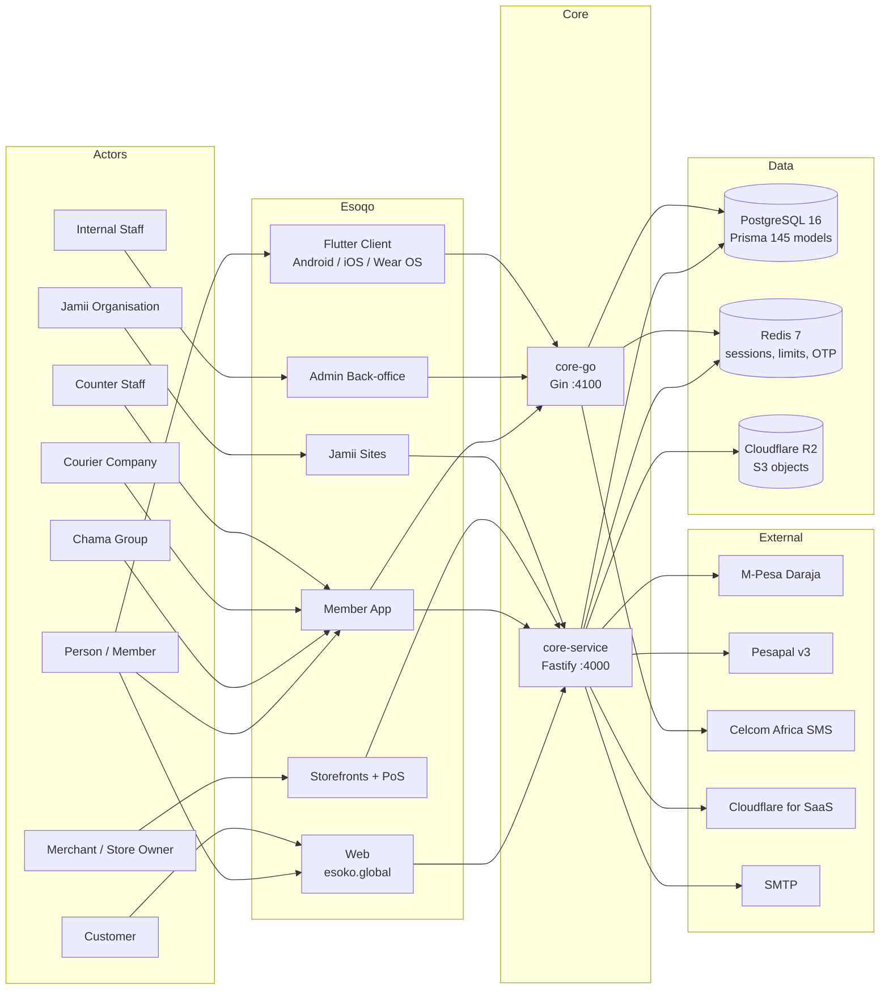

---

## 3. Architectural Design

### 3.1 System Architecture Diagram

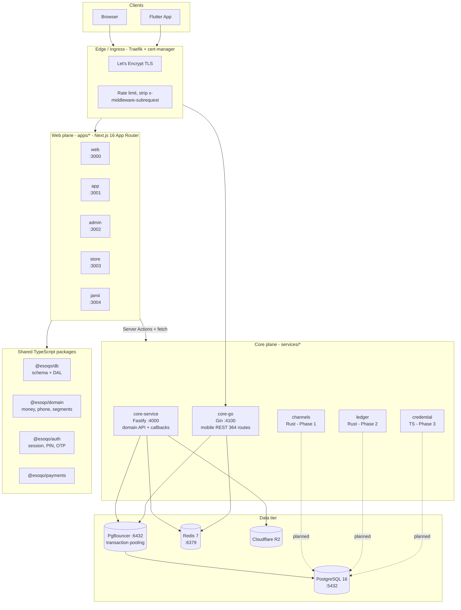

### 3.2 Component Breakdown

| Component                | Location                  | Responsibilities                                                                                                                                                                                     | Interactions                                                      |
| ------------------------ | ------------------------- | ---------------------------------------------------------------------------------------------------------------------------------------------------------------------------------------------------- | ----------------------------------------------------------------- |
| **web**                  | `apps/web`                | Public marketing, institution/county directories, pricing, public verification (`/verify`, `/p/[code]`), parcel tracking, event pages, SSE counter-ticket stream                                     | Prisma via DAL; `core` for payments                               |
| **app**                  | `apps/app`                | Member app: sign-in, PIN, consents, documents, group membership, tickets, vouchers, payments, and the polymorphic `/org/[type]` portal for `chama`, `courier`, `eatery`, `hotel`, `ticket`, `tout`   | DAL; `core-go` over `Authorization: Bearer`                       |
| **admin**                | `apps/admin`              | Internal staff back-office: registrations, groups, staff, payments, e-stores, parcels, ticketing, Jamii, audit-chain viewer, fraud, sectors, support tickets                                         | DAL; `core-go` via `lib/go-ticketing.ts`                          |
| **store**                | `apps/store`              | Multi-tenant storefronts (`/@handle`, `/s/[slug]`, `/m/[mallSlug]`) and the PoS terminal (`/dashboard/pos`), cashier sign-in, shifts, receipts, debts, stock                                         | DAL; `core` for payment confirmation                              |
| **jamii**                | `apps/jamii`              | Whitelabel organisation sites at `/o/[slug]`, custom-domain middleware, campaigns, donations, gallery, pages, posts, leadership, team                                                                | DAL; `core` for donation callbacks and domain reconcile           |
| **core-service**         | `services/core`           | Domain API, M-Pesa STK callback, Pesapal IPN, store/registration/donation payment confirmation, CECF service ingestion (HMAC), Jamii domain reconcile, contribution-gap group alert job              | Fastify → `packages/db` → Prisma; Redis; R2                       |
| **core-go**              | `services/core-go`        | Mobile REST API (364 routes) across parcels, transport, groups, stores, PoS, treasury, bills, vouchers, fleet, loyalty. Owns Go DAL, sessions, PIN/OTP, M-Pesa, storage, QR minting, SMS composition | Gin → `internal/dbx` → pgx → PgBouncer; Redis; R2                 |
| **cecf-wordpress**       | `services/cecf-wordpress` | Child-care-centre registration site. WordPress Bedrock + Sage Multisite + the `cecf-sage` theme, pnpm-packaged                                                                                       | MariaDB; posts registrations into `core` with an HMAC-signed body |
| **@esoqo/db**            | `packages/db`             | 145-model Prisma schema, 114 migrations, the DAL barrel, capability engine, audit chain, storage adapter                                                                                             | Prisma → PgBouncer                                                |
| **@esoqo/domain**        | `packages/domain`         | Pure business logic: `money.ts`, `phone.ts`, `segments.ts` (92 kinds / 595 aliases), `counties.ts`, `env.ts`                                                                                         | None — leaf package                                               |
| **@esoqo/auth**          | `packages/auth`           | Opaque Redis-backed sessions, Argon2id PINs, OTP, Celcom SMS, SMTP email, rate limiting                                                                                                              | Redis; `db`; Celcom; SMTP                                         |
| **@esoqo/payments**      | `packages/payments`       | M-Pesa Daraja STK Push client; Pesapal v3 client                                                                                                                                                     | Safaricom; Pesapal                                                |
| **@esoqo/ui**            | `packages/ui`             | Design system and the parcel offline booking queue                                                                                                                                                   | Local                                                             |
| **mobile/esoqo_app**     | `mobile/esoqo_app`        | Flutter client, 14 features, Riverpod state, feature-first layout                                                                                                                                    | `core-go`; R2; `printing`/`pdf` for labels and receipts           |
| **channels** (planned)   | `services/channels`       | USSD/SMS/WhatsApp gateway. 120s sessions with resumption, ≤182-char screens                                                                                                                          | `db`                                                              |
| **ledger** (planned)     | `services/ledger`         | Double-entry ledger, escrow, settlement. **Not AI-owned** (ADR-0004)                                                                                                                                 | `db`                                                              |
| **credential** (planned) | `services/credential`     | SD-JWT VCs, OID4VCI, W3C VCDM 2.0                                                                                                                                                                    | `db`; KMS-held keys                                               |

### 3.3 Technology Stack

| Layer            | Choice                                           | Version             | Notes                                                                    |
| ---------------- | ------------------------------------------------ | ------------------- | ------------------------------------------------------------------------ |
| Monorepo         | pnpm workspaces + Turborepo                      | pnpm 9.12.0         | 4 globs plus the nested PHP theme                                        |
| Runtime          | Node.js                                          | 22.12.0 (`.nvmrc`)  |                                                                          |
| Web framework    | Next.js App Router                               | 16                  | React 19, Turbopack, `output: "standalone"`, `typedRoutes: true`         |
| Core API (web)   | Fastify                                          | 5                   | `helmet`, `@fastify/rate-limit`, CORS, `bodyLimit: 256KB`, log redaction |
| Mobile API       | Gin                                              | —                   | Go 1.25, `pgx/v5`, `go-redis/v9`                                         |
| Planned services | Rust, Python                                     | —                   | ADR-0004                                                                 |
| Mobile           | Flutter / Dart                                   | —                   | Riverpod; Android, iOS, Wear OS, web                                     |
| Database         | PostgreSQL                                       | 16-alpine           | `pgcrypto`, `citext`, `pg_trgm` extensions                               |
| ORM              | Prisma                                           | 6                   | Go uses `pgx` directly against the same schema                           |
| Connection pool  | PgBouncer                                        | `edoburu/pgbouncer` | Transaction pooling on `DATABASE_URL`                                    |
| Cache / broker   | Redis                                            | 7-alpine            | Sessions, rate limits, OTP, pub/sub                                      |
| Object storage   | Cloudflare R2                                    | —                   | S3-compatible via `aws-sdk-v2`                                           |
| Payments         | M-Pesa Daraja, Pesapal v3                        | —                   | STK Push; IPN                                                            |
| SMS              | Celcom Africa                                    | —                   | `console` / `mock` / `production`                                        |
| Containerisation | Docker                                           | —                   | Debian slim for Node (Prisma libc), Alpine for Go (`CGO_ENABLED=0`)      |
| Orchestration    | Kubernetes + Kustomize + Rancher Fleet           | —                   | Traefik ingress, cert-manager                                            |
| Registry         | GitHub Container Registry                        | —                   | `ghcr.io/emmanuel-odero/*`                                               |
| CI               | GitHub Actions                                   | —                   | 3 workflows                                                              |
| E2E              | Playwright + `@axe-core/playwright`              | —                   | `apps/app/e2e/`                                                          |
| Unit (TS)        | Vitest                                           | —                   | `packages/domain`, `packages/ui`                                         |
| Unit (Go)        | `go test`                                        | —                   | `internal/{authsvc,config,dbx}`                                          |
| Lint             | ESLint (`@esoqo/config`) + `flutter_lints` 6     | —                   | Carries the load-bearing `no-restricted-imports` rules                   |
| Type safety      | TypeScript `strict` + `noUncheckedIndexedAccess` | —                   | Both Node Dockerfiles typecheck at build time                            |

### 3.4 Data Flow and Control Flow

#### 3.4.1 Authentication and authorisation

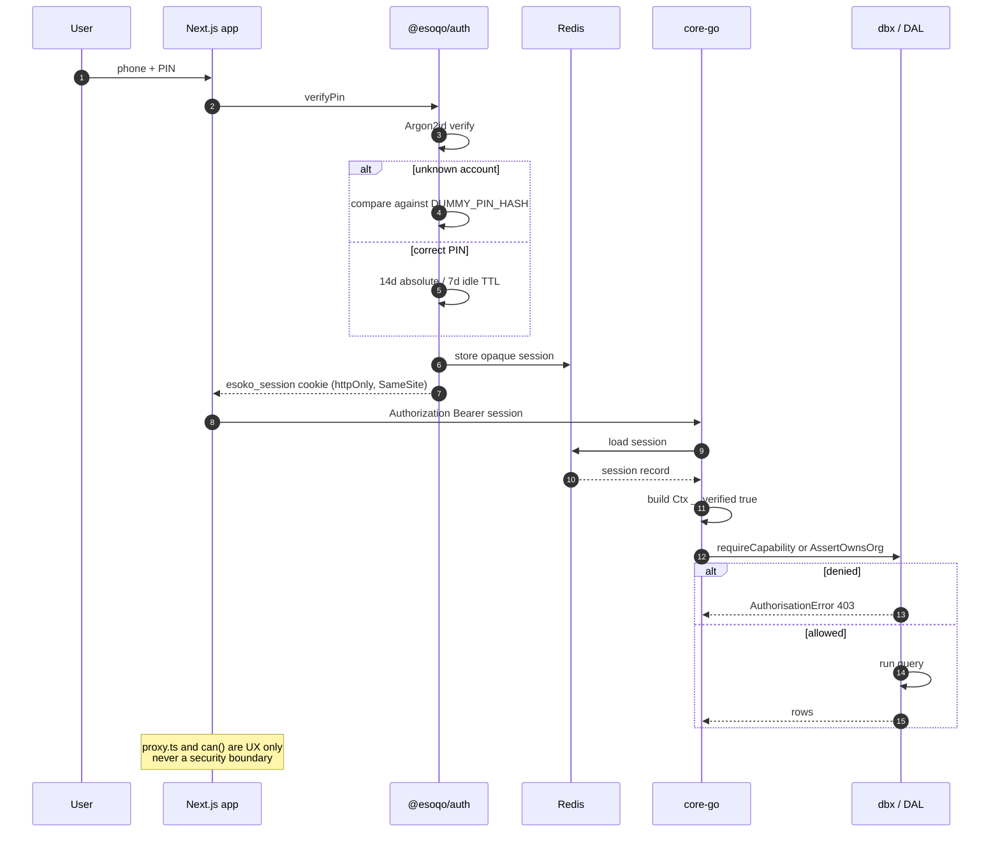

#### 3.4.2 Payment, ledger and notification flow

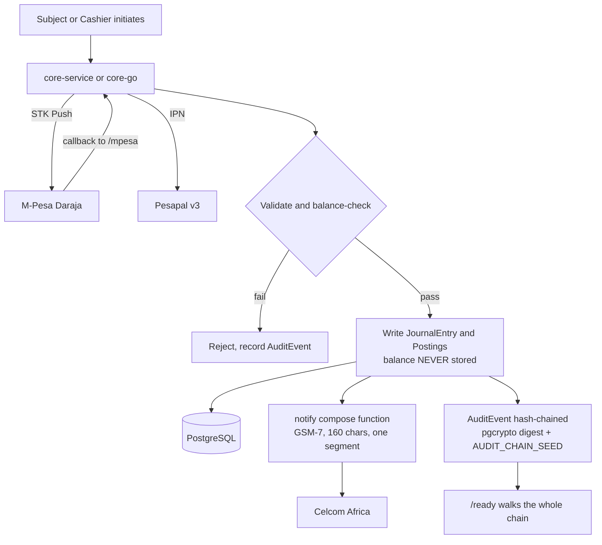

#### 3.4.3 Parcel lifecycle (ADR-0006 — one run, first-class routes)

ADR-0006 exists because a single lorry from Nairobi to Kisumu was previously two rows in two
unrelated tables. The corrected model separates cargo from journey and gives both a route.

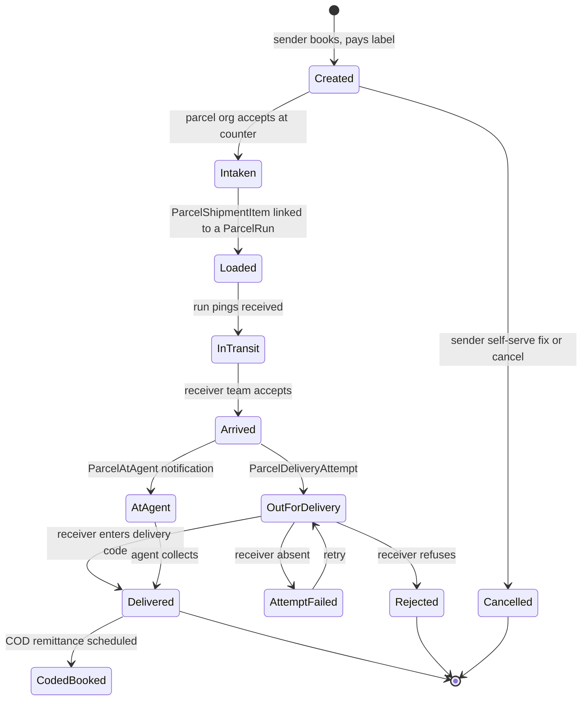

Every transition writes a `ParcelEvent` and a hash-chained `AuditEvent`.

---

## 4. Detailed Design

### 4.1 `services/core-go` — Mobile REST API

**Responsibilities.** Serve the Flutter client. Own the Go-side implementation of every
authorisation rule, business invariant and money calculation, ported from the TypeScript DAL rather
than re-derived. Compose all outbound SMS. Mint signed short codes. Persist and serve images.

**Structure.** `cmd/api/main.go` constructs two `pgx` pools — a pooled one for request traffic and
a small second one, from `DIRECT_DATABASE_URL`, reserved for `LISTEN`/`NOTIFY` (session
invalidation cannot be seen through PgBouncer's transaction pool).

Eighteen internal packages:

| Package       | Responsibility                                                                                                                            |
| ------------- | ----------------------------------------------------------------------------------------------------------------------------------------- |
| `httpapi`     | Gin router, middleware, ~36 `handlers_*.go` files, 364 routes                                                                             |
| `dbx`         | The Go DAL — ~40 files. Largest: `parcels.go` (74 fns), `parcel_orgs.go` (46), `ticket_orgs.go` (44), `fleet.go` (32), `treasury.go` (31) |
| `authsvc`     | Sessions, PIN, OTP, org sessions, capability resolution, lockout, SMS budget                                                              |
| `payments`    | M-Pesa and Pesapal clients, mirroring `@esoqo/payments`                                                                                   |
| `config`      | Environment parsing                                                                                                                       |
| `notify`      | One pure compose function per SMS event                                                                                                   |
| `storage`     | R2/S3 image store, mirroring `packages/db/src/storage.ts` rule for rule                                                                   |
| `ledger`      | Posting validation, balance derivation                                                                                                    |
| `money`       | Integer-cents arithmetic                                                                                                                  |
| `fleetqr`     | HMAC-SHA256 signed short codes                                                                                                            |
| `audit`       | Hash-chained audit event writing and verification                                                                                         |
| `orgtypes`    | Typed org context and capability derivation                                                                                               |
| `phone`       | Kenyan MSISDN normalisation                                                                                                               |
| `redisclient` | Shared Redis connection                                                                                                                   |
| `loyalty`     | Points accrual and redemption                                                                                                             |
| `seed`        | Go seeder, replacing `prisma/seed.ts`                                                                                                     |

**Interfaces.**

_Inputs._ `Authorization: Bearer <opaque session>`; `X-Esoqo-Org-Context` for org consoles;
JSON bodies; multipart image uploads (capped by ingress at 12 MB on app hosts, 2 MB on API hosts).

_Outputs._ JSON. Errors are typed, not prose — `GoRequestError` carries a machine-readable `code`
so clients branch on the code and never regex a message.

_Error handling._ `AuthorisationError` → 403 before any query. `LABEL_ALREADY_SPENT` → the offline
queue in `packages/ui/src/parcelOfflineQueue.ts` reads this to conclude that a replayed booking
already succeeded rather than double-booking. `authRequired` returns 401. Malformed capability
contexts are rejected, never defaulted.

**Key algorithms.**

`fleetqr` mints a single unified short-code namespace. Alphabet
`ABCDEFGHJKMNPQRSTUVWXYZ23456789` — `0`/`O`, `1`/`I` and `L` are excluded so codes survive being
read aloud or copied off a printed label. Prefixes: `TRIP` boarding, `BUS`, `VCH` vouchers, `TKT`
events, `PKP` store pickup, `ESK` payment id, `PKG` parcel, `TCK` service ticket, plus luggage tags
carrying a hand-typed checksum. Go never renders a QR image; scanners always re-verify the MAC
against `FLEET_QR_SECRET`, so a forged payload is useless.

`notify` treats SMS as a cost problem. A single non-GSM-7 rune — an em dash, a curly quote, an
emoji — moves the message from GSM-7 to UCS-2 and drops the budget from 160 to 70 characters per
segment, silently billing two to three messages instead of one. Free-text fields are capped at
`smsFieldMaxLen = 20` and truncated with ASCII `...`. `TestNoMessageForUCS2` enforces it.

`storage` never trusts a declared MIME type — magic bytes decide. The client filename is never
used as a path. Size is capped before the write. Nothing is served from the package; reads go
through a signed URL. Only images are handled on the Go side; the PDF and OOXML branches in the
TypeScript adapter are deliberately absent, as unused attack surface.

**State management.** Stateless. Sessions live in Redis; nothing request-scoped is held in process
memory, so any replica can serve any request.

### 4.2 `services/core` — Domain API and payment callbacks

**Responsibilities.** Everything that is not mobile traffic: payment callbacks from M-Pesa and
Pesapal, partner ingestion, scheduled jobs, and Cloudflare for SaaS domain reconciliation.

**Routes.**

| Route                                          | Purpose                                           |
| ---------------------------------------------- | ------------------------------------------------- |
| `POST /api/cecf/registration/start`            | Begin a child-care-centre registration            |
| `POST /api/cecf/.../payments/mpesa/initiate`   | STK Push for a registration fee                   |
| `POST /api/cecf/.../payments/pesapal/initiate` | Pesapal order for a registration fee              |
| `POST /internal/jamii-domains/reconcile`       | Sync custom hostnames to Jamii orgs               |
| `GET /health`                                  | **Liveness.** Cheap. Never walks the audit chain. |
| `GET /ready`                                   | **Readiness.** Walks the full audit chain.        |

Also owns the M-Pesa STK callback, the Pesapal IPN, and store, registration and donation payment
confirmation.

**Error handling and security.** CECF ingestion is authenticated with HMAC-SHA256 over the raw
request body using `CECF_SERVICE_SECRET`, compared with `timingSafeEqual` — never `===`.

**The liveness/readiness split is load-bearing and must not be collapsed.** Pointing liveness at
`/ready` turns one broken audit link into a cluster-wide restart loop: every replica fails
liveness, is killed, comes back, fails the audit walk again, and is killed again. The header
comment in `deploy/k8s/base/core-services.yaml` says so, and it should not be edited away.

**Jobs.** `src/jobs/group-alerts.ts` sends a contribution-gap SMS digest, and fires only on the
exact day a group crosses `QUIET_DAYS = 14` — not every day after, which would spam a dormant
group for months.

### 4.3 `@esoqo/db` — Schema, DAL and authorisation engine

**Responsibilities.** Own the schema and the only sanctioned read/write path. Resolve
authorisation. Write the audit chain. Abstract object storage.

**Interfaces.** `src/dal/index.ts` is the barrel and the only legitimate import surface. Importing
`@prisma/client` directly, or a deep `dal/*` path from outside the package, is blocked by an
ESLint `no-restricted-imports` rule. `src/client.ts` is the only place a `PrismaClient` is
constructed — `selectDatabaseUrl()` swaps in `PROD_DATABASE_URL` when `APP_ENV=LOCAL_TEST_PROD`,
and **throws** in `development` if the database host is not local, so a developer machine can
never write to production.

**Data structures.** The capability engine. `Ctx` carries `actorType` (`SUBJECT`, `STAFF`, `AGENT`,
`SYSTEM`, `ISSUER`), `actorId`, `capabilities[]`, and optional `partyId`, `orgId`, `storeId`,
`ticketOrgId`, `ip`. It is `readonly __verified: true`, set only by `@esoqo/auth` from a verified
session — never from a request header, which is exactly the CVE-2025-29927 shape.
`systemCtx(reason)` exists for migrations, workers and seeds.

`CAPABILITY_CATALOGUE` is the source the admin role editor renders from, so adding a capability
makes it appear in the UI with no front-end change. `ROLE_PRESETS` and `CASHIER_CAPABILITIES`
bundle them: a `CASHIER` gets the till and nothing else; a `MANAGER` gets the till plus operations
but **never** `store.write` or `cashier.write`.

**Logic.** `requireCapability(ctx, cap, opts)` throws `AuthorisationError` unless
`ctx.__verified === true` and the capability is granted. Wildcards are supported at resource,
action, and whole-string level. `:own` means the target's `partyId`/`subjectId` equals
`ctx.partyId`.

`recordAudit` computes `hash = digest(prevHash || canonicalPayload, AUDIT_CHAIN_SEED)`.
`verifyChain` walks the whole sequence; `/ready` calls it.

**Organisation model.** `ParcelOrg`, `TicketOrg` and the generic `Organisation` were unified onto
polymorphic org tables so that `/org/[type]` can serve `chama`, `courier`, `eatery`, `hotel`,
`ticket` and `tout` from one shell. **Migration is transitional:** `Ctx` still carries a
`DEPRECATED` `ParcelOrgID` alongside the generic `OrgID`/`OrgType`, which is a divergence risk
between the two auth paths and should be removed (Appendix B, item 2).

### 4.4 `services/core-go` → Next.js bridge

`apps/admin/src/lib/go-ticketing.ts` and `apps/app/src/lib/ticketing.ts` forward the existing
staff session cookie as `Authorization: Bearer` to `CORE_GO_API_URL` (default
`http://localhost:4100`). The session format is identical to the TypeScript side because both read
the same Redis record; Go enforces with `RequireCapability`; the TypeScript side only shapes the UX.

Next.js pages deliberately keep `can`/`matches` helpers **local** rather than importing them from
`@esoqo/db`, so the only thing they take from the database package is the error class and the
capability _type_. No Prisma, no DAL, no chance of accidentally crossing the boundary.

### 4.5 `mobile/esoqo_app` — Flutter client

**Responsibilities.** The member-facing mobile experience: 14 features — account, activity, auth,
bills, fleet, groups, home, money, parcels, scan, shopping, tickets, vouchers.

**Structure.** Feature-first, per `mobile/esoqo_app/ARCHITECTURE.md`:

```text
lib/
  core/       api, auth, money, storage, theme, widgets, router.dart
  features/   <feature>/
                <feature>_models.dart
                <feature>_repository.dart
                <feature>_screen.dart
                <feature>_providers.dart
```

Riverpod for state. Three structural rules and 60–120 fps rendering rules are stated in that
document. Notable dependencies: `printing ^5.13.4` and `pdf ^3.11.1` for labels and receipts.

**State management.** Riverpod providers per feature, with the repository layer as the single
network seam — screens never call `core/api` directly.

### 4.6 Multi-tenancy and custom domains

| App                 | Mechanism                                                                                                                                                                 |
| ------------------- | ------------------------------------------------------------------------------------------------------------------------------------------------------------------------- |
| `store`             | `apps/store/proxy.ts` maps `<slug>.esoko.global` to `/s/[slug]`; `apps/store/src/app/[handle]/page.tsx` also handles `esoko.global/@slug`                                 |
| `jamii`             | `apps/jamii/src/middleware.ts` maps a custom domain to `/o/[slug]`                                                                                                        |
| Cloudflare for SaaS | `services/core/src/lib/cloudflare-saas.ts` maps custom hostnames to orgs; `POST /internal/jamii-domains/reconcile` runs every 5 minutes from `jamii-domain-reconcile.yml` |
| `app`               | Typed `/org/[type]` routes replace the legacy `org/[orgId]` portal (commit `8c8b683`)                                                                                     |

`apps/app/proxy.ts` strips `x-middleware-subrequest` as defence against CVE-2025-29927.

### 4.7 `packages/domain` — shared pure logic

| Module        | Content                                                                                                                                                              |
| ------------- | -------------------------------------------------------------------------------------------------------------------------------------------------------------------- |
| `money.ts`    | 197 lines. Integer minor units, allocation, formatting. The TS twin of `internal/money/money.go`                                                                     |
| `phone.ts`    | Kenyan MSISDN normalisation (49 lines)                                                                                                                               |
| `segments.ts` | 92 trade/work kinds, 595 aliases across English, Kiswahili and Sheng. `searchSegments` always returns an affirmation — a carpenter who does not see carpentry leaves |
| `counties.ts` | 14 Kenyan counties                                                                                                                                                   |
| `env.ts`      | The `APP_ENV` master switch (below)                                                                                                                                  |

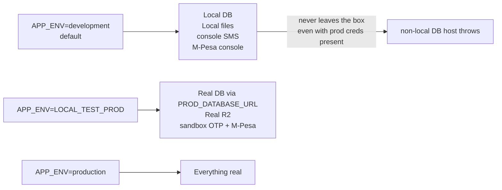

Development stays local **even when production credentials are present in the environment.** Each
provider additionally has its own switch — `MPESA_PROVIDER`, `SMS_PROVIDER` + `SMS_TEST_ENV`,
`STORAGE_PROVIDER`, `JAMII_DOMAIN_PROVIDER` ∈ `console | mock | sandbox | production`.

---

## 5. Database Design

**PostgreSQL 16**, single database, 145 Prisma models and 69 enums, 114 migrations, ~5,800 lines
of SQL. The Go seeder in `services/core-go/internal/seed` replaced `prisma/seed.ts`.

Extensions enabled at init: `pgcrypto` (`gen_random_uuid`, `digest`), `citext`, `pg_trgm` (fuzzy
entity resolution during onboarding). The init script also creates the `esoqo_app` role with
`NOBYPASSRLS`.

### 5.1 Core ER diagram

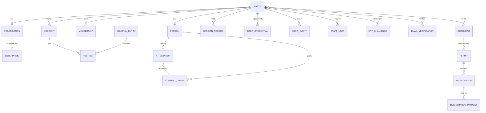

### 5.2 Commerce ER diagram

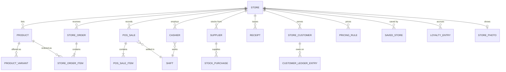

### 5.3 Transport ER diagram

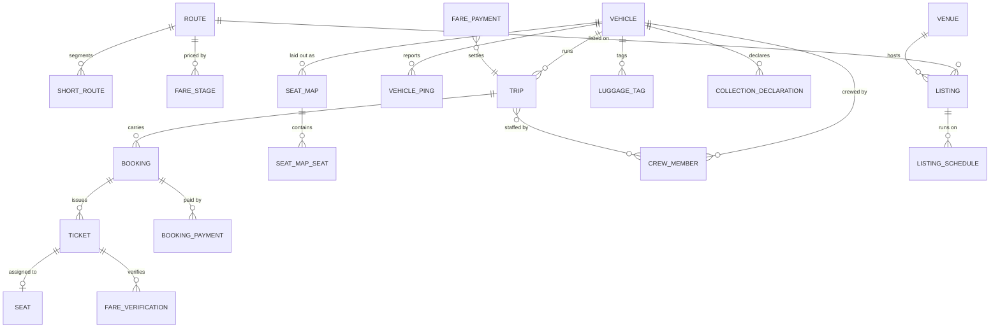

### 5.4 Parcel ER diagram

```mermaid
erDiagram
    PARCEL ||--o| PARCEL_SHIPMENT : "travels on"
    PARCEL_SHIPMENT ||--o{ PARCEL_SHIPMENT_ITEM : contains
    PARCEL ||--o{ PARCEL_EVENT : "raises"
    PARCEL ||--o{ PARCEL_DELIVERY_ATTEMPT : "attempts"
    PARCEL ||--o{ PARCEL_HANDOFF : "hands off at"
    PARCEL ||--o| PARCEL_COD_REMITTANCE : "settles via"
    PARCEL_ORG ||--o{ PARCEL : "accepts"
    PARCEL_ORG ||--o{ PARCEL_LABEL_STOCK : "holds"
    PARCEL_ORG ||--o{ PARCEL_COD_POLICY : "sets"
    PARCEL_ORG ||--o{ PARCEL_RUN_CREW : "crews"
    PARCEL_ORG ||--o{ PARCEL_RUN_RECEIVER : "receives at"
    PARCEL_RUN_CREW }o--o| COURIER_TEAM_MEMBER : "is"
    PARCEL_ZONE ||--o{ PARCEL : "priced in"
    PARCEL_ZONE ||--o{ PARCEL_PRICING_RULE : "priced by"
    PARCEL_ZONE ||--o{ PARCEL_DISTANCE_RATE : "rated by"
    PARCEL_ZONE ||--o{ PARCEL_COVERAGE_TIER : "covered by"
    PARCEL_ORG ||--o{ PARCEL_ROUTE : "runs"
    PARCEL_ROUTE ||--o{ PARCEL_ROUTE_STOP : "stops at"
    PARCEL_ORG ||--o{ PARCEL_ORG_STAFF : employs
    PARCEL_ORG ||--o{ PARCEL_AGENT : "operates"
    PARCEL_AGENT ||--o{ PARCEL_HANDOFF : "receives at"
    PARCEL ||--o{ PARCEL_RUN_PING : "pings"
    PARCEL ||--o{ PARCEL_COURIER : "carried by"
    PARCEL_ORG ||--o{ PARCEL_COURIER_TARIFF : "charges"
    PARCEL_COUNTER_TICKET }o--|| PARCEL : "counters"
```

### 5.5 Groups, Jamii and supporting ER diagram

```mermaid
erDiagram
    ORGANISATION ||--o{ MEETING : "holds"
    MEETING ||--o{ ATTENDANCE_RECORD : records
    ORGANISATION ||--o{ GROUP_TREASURY_POLICY : "governed by"
    ORGANISATION ||--o{ GROUP_SIGNER : "authorised by"
    ORGANISATION ||--o{ GROUP_CONTRIBUTION : receives
    ORGANISATION ||--o{ WITHDRAWAL_REQUEST : "requests"
    WITHDRAWAL_REQUEST ||--o{ WITHDRAWAL_SIGNATURE : "signed by"
    ORGANISATION ||--o{ GROUP_CREDIT_INSIGHT_SNAPSHOT : measures
    ORGANISATION ||--o{ ESOQO_PAYMENT_ID : "identified by"
    ORGANISATION ||--o{ JAMII_DOMAIN : "served by"
    ORGANISATION ||--o{ CAMPAIGN : "runs"
    CAMPAIGN ||--o{ CAMPAIGN_UPDATE : updates
    CAMPAIGN ||--o{ DONATION : receives
    ORGANISATION ||--o{ JAMII_POST : publishes
    ORGANISATION ||--o{ JAMII_PAGE : "has pages"
    JAMII_PAGE ||--o{ JAMII_PAGE_BLOCK : "built from"
    ORGANISATION ||--o{ JAMII_TEAM_MEMBER : "staffed by"
    ORGANISATION ||--o{ SUPPORT_TICKET : "raises"
    PARTY ||--o{ BILL : "billed"
    BILL ||--o{ BILL_CONTRIBUTION : itemises
    BILL ||--o{ BILL_PAYMENT : "paid by"
    PARTY ||--o{ VOUCHER_CARD : holds
    VOUCHER_CARD ||--o{ VOUCHER_LEDGER_ENTRY : "journals"
    VOUCHER_BATCH ||--o{ VOUCHER_CARD : issues
    ORGANISATION ||--o{ SITE_VISIT : hosts
    ORGANISATION ||--o{ SMS_SPEND : "spends"
    PARTY }o--o| PARTY_LOYALTY_ENTRY : accrues
```

### 5.6 Tables — representative field definitions

Full definitions are in `packages/db/prisma/schema.prisma` (5,982 lines). The conventions that
matter:

**Identity**

| Table            | Key fields                                                                   | Constraints                                     |
| ---------------- | ---------------------------------------------------------------------------- | ----------------------------------------------- |
| `Party`          | `id` (uuid PK), `kind` (`PERSON`/`ORGANISATION`)                             | Root discriminator; exactly one subtype         |
| `Person`         | `id` (PK, FK→Party), `firstName`, `lastName`, `phone` (citext), `nationalId` | `phone` unique; `nationalId` unique, nullable   |
| `Organisation`   | `id` (PK, FK→Party), `name`, `slug` (unique), `type`, `countyId`             | `slug` unique — it is the tenancy key           |
| `Membership`     | `partyId` (FK), `organisationId` (FK), `role`, `status`                      | Composite unique on `(partyId, organisationId)` |
| `UserCredential` | `partyId` (FK), `pinHash` (argon2id), `failedAttempts`, `lockedUntil`        | `pinHash` never selected into any DTO           |
| `OtpChallenge`   | `partyId`, `codeHash`, `expiresAt`, `consumedAt`                             | Single-use; `codeHash` not `code`               |
| `ConsentGrant`   | `subjectId` (FK), `scope`, `granteeId`, `grantedAt`, `revokedAt`             | Revocation is a timestamp, never a delete       |

**Ledger** — the only tables with money.

| Table             | Key fields                                                                         | Constraints                                             |
| ----------------- | ---------------------------------------------------------------------------------- | ------------------------------------------------------- |
| `Account`         | `id`, `partyId` (FK), `kind`, `currency`                                           | One account per party per kind per currency             |
| `JournalEntry`    | `id`, `occurredAt`, `memo`, `reference`                                            | Balanced: Σdebits ≡ Σcredits, enforced in code          |
| `Posting`         | `id`, `journalEntryId` (FK), `accountId` (FK), `amountMinor` (BigInt), `direction` | **No stored balance column, on any table**              |
| `PaymentApproval` | `journalEntryId`, `approverId`, `approvedAt`                                       | Separation of duties via `signPaymentApproval`          |
| `AuditEvent`      | `id`, `seq`, `actorId`, `action`, `payload` (jsonb), `prevHash`, `hash`            | `seq` unique; `hash = digest(prevHash ‖ payload, seed)` |

Money is `BigInt` minor units in Go and `Decimal(12,2)` / integer cents in TypeScript. There are no
floats in either money path. `Decimal(12,2)` caps a single amount at 10,000,000,000.00 — adequate
for the pilot, and worth revisiting before multi-currency (Appendix B, item 6).

**Parcel** — the ADR-0006 model.

| Table                             | Owns            | Notes                                                                                            |
| --------------------------------- | --------------- | ------------------------------------------------------------------------------------------------ |
| `ParcelShipment`                  | **the cargo**   | `ParcelShipmentItem` links each parcel to the run with `loadedAt`, `offloadedAt`, exception code |
| `ParcelRun`                       | **the journey** | Real station foreign keys, crew with roles, receiving team, `ParcelRunPing` GPS trail            |
| `ParcelRoute` / `ParcelRouteStop` | the path        | Ordered stops, not free text                                                                     |
| `ParcelEvent`                     | the history     | Append-only                                                                                      |

The three free-text columns that used to carry sense of place — `originLabel`,
`destinationLabel`, `routeLabel` — now label what is already a real foreign key. They survive as
display labels only.

**Organisation subtype tables** — `ParcelOrg`, `TicketOrg`, `OrgStaffGrant`. The generic
`Organisation` carries shared attributes; each subtype table carries org-type-specific ones. This
is what makes `/org/[type]` possible and is why the legacy `org/[orgId]` portal was retired.

### 5.7 Relationships — design rules

1. **`Party` is the only identity root.** Nothing authenticates that is not a `Party` or an
   `ActorType`-bearing staff/agent context.
2. **Money flows through `Posting` only.** No table stores a balance. A balance is a `SUM` over
   postings — correct by construction, and the reason `packages/db/src/audit.ts` and
   `internal/ledger` both validate on write.
3. **Cargo and journey are separate tables with real foreign keys** (ADR-0006).
4. **Subtype tables for org types**, joined to the generic `Organisation` — polymorphic, not
   duplicated.
5. **Consent is a first-class table, not a boolean.** `ConsentGrant` with `revokedAt` is what makes
   the Data Protection Act 2019 posture defensible.
6. **Audit is append-only and hash-chained.** No update or delete path exists.

### 5.8 Migration Strategy

- Prisma migrations, 114 applied in lexical order, ~5,800 lines of SQL.
- Applied by a Kubernetes `migrate-job` in `deploy/k8s/base/migrate-job.yaml`, not by a service at
  boot. Two services starting simultaneously must not race to migrate.
- **Migrations connect with `DIRECT_DATABASE_URL`, not `DATABASE_URL`.** Prisma migrations,
  `pg_dump` and the audit-chain walk all require a direct connection; none survive transaction
  pooling. Both URLs are generated by `deploy/scripts/create-secrets.sh` and must not be hand-written.
- The recent polymorphic-org migration is a worked example of a multi-step, data-preserving
  migration (commit `28da22a` migrated parcel orgs onto the generic tables; `d6fe6e8` corrected
  column names). The sequencing — additive schema, data backfill, cutover, then constraint
  tightening — is the pattern to follow.
- Rollback is `git revert` of a commit, and a database restore from `backup-cronjob` or
  `deploy/scripts/restore-job.yaml`.

---

## 6. External Interfaces

### 6.1 User Interface

| Surface           | Stack              | Notes                                                                                                                    |
| ----------------- | ------------------ | ------------------------------------------------------------------------------------------------------------------------ |
| Public site       | `apps/web`         | Marketing, directories, `/verify`, `/p/[code]`, parcel tracking, event pages                                             |
| Member app (web)  | `apps/app`         | Consents, documents, group, tickets, vouchers, payments, and the typed `/org/[type]` portal                              |
| Admin console     | `apps/admin`       | Registrations, groups, staff, payments, e-stores, parcels, ticketing, Jamii, audit chain, fraud, support tickets         |
| Storefronts + PoS | `apps/store`       | Tenant storefront, mall directory, PoS terminal, cashier sign-in, shifts, receipts, debts, stock, reports                |
| Jamii sites       | `apps/jamii`       | Whitelabel org site plus its own admin dashboard                                                                         |
| Mobile            | `mobile/esoqo_app` | 14 features; Android, iOS, Wear OS, web                                                                                  |
| Counter terminal  | `apps/app` + docs  | Assisted booking; SSE stream on `apps/web/api/parcels/counter-tickets/[id]/stream`. UX documented in `docs/COUNTER_*.md` |

Design system is `@esoqo/ui`, shared by all five web apps via `transpilePackages`. Accessibility
helpers are `@esoqo/a11y`, with `@axe-core/playwright` assertions in E2E.

---

### 6.2 Brand and Visual Identity

The brand is specified in two places, and they are not yet reconciled — see §11.2 items 14–22.

- **`assets/branding/`** — the logo artwork, the source of truth for identity.
- **`packages/ui/src/tokens.css`** — the design tokens, described in its own header as
  "the single source of truth" for colour. It is the source of truth for the _product_; the logo
  artwork lives separately.

#### 6.2.1 Logo assets

`assets/branding/` holds 11 files. All are RGBA PNG on a transparent background except the maskable
icon, which is opaque white-backed by design.

**Primary lockup** — `esoqo-transparent-bg-logo.png`, 2054 × 766, the highest-resolution master:


**Full lockup, navy wordmark** — `ESOQO-full-name-removebg-logo.png`, 818 × 305. This is the file
actually served as `esoko-logo-light.png` and `esoko-logo.png`:


**Inverse lockup** — `esoqo-full-logo-removebg-preview.png`, 506 × 168. Predominantly white
(77.5% of pixels fully transparent, the remainder near-white), intended for dark backgrounds.
Served as `esoko-logo-dark.png`:


**Mark only** — `esoqo-icon-removebg-preview.png`, 537 × 464:


**Icon set** — `favicon-16x16.png`, `favicon-32x32.png`, `favicon.ico`, `icon-192x192.png`,
`icon-512x512.png`, `maskable-icon-512x512.png`, `apple-touch-icon.png`, plus `icon.svg`.

| Asset                                  | Dimensions | Role                        | Transparency  |
| -------------------------------------- | ---------- | --------------------------- | ------------- |
| `esoqo-transparent-bg-logo.png`        | 2054 × 766 | Master lockup               | 73.1%         |
| `ESOQO-full-name-removebg-logo.png`    | 818 × 305  | Served lockup (navy)        | 75.8%         |
| `esoqo-full-logo-removebg-preview.png` | 506 × 168  | Inverse lockup (white)      | 77.5%         |
| `esoqo-icon-removebg-preview.png`      | 537 × 464  | Mark only                   | 64.3%         |
| `icon-192x192.png`                     | 192 × 192  | PWA icon                    | 75.7%         |
| `icon-512x512.png`                     | 512 × 512  | PWA icon                    | 75.2%         |
| `maskable-icon-512x512.png`            | 512 × 512  | PWA maskable                | 0.4% (opaque) |
| `apple-touch-icon.png`                 | 180 × 180  | iOS home screen             | 76.1%         |
| `favicon-16x16.png`                    | 16 × 16    | Favicon                     | 84.4%         |
| `favicon-32x32.png`                    | 32 × 32    | Favicon                     | 80.1%         |
| `favicon.ico`                          | 16 × 16    | Favicon (see §11.2 item 20) | —             |

#### 6.2.2 Measured logo palette

Sampled from the artwork at alpha ≥ 200. These are **derived from the files, not declared
anywhere** — no colour values for the logo are recorded in source.

| Role          | Hex                   | Where                                  |
| ------------- | --------------------- | -------------------------------------- |
| Wordmark navy | `#042C62` – `#052D68` | Full-lockup wordmark                   |
| Mark red      | `#F7001C` – `#FE220D` | Mark, leading edge of the gradient     |
| Mark orange   | `#FF6109` – `#FF9B04` | Mid-gradient                           |
| Mark amber    | `#FDB807`             | Trailing edge, most visible at 16 × 16 |
| Inverse white | `#FFFFFF`             | Inverse lockup                         |

**The mark is a red → orange → amber gradient, not a flat colour.** This matters: it cannot be
reproduced from a single hex token, and no token represents it.

#### 6.2.3 Product design tokens

`packages/ui/src/tokens.css` declares a colour **semantics** rule, which is the most useful part of
the brand definition and should be treated as binding:

```text
navy  = authority      · headers, footers, institutional bands
green = you and yours  · your record, verified, primary action
blue  = institutions   · issuers, data, information
red   = attention only · the mark, safety notices, errors
```

| Token                                 | Hex                               | Semantic role                             |
| ------------------------------------- | --------------------------------- | ----------------------------------------- |
| `--navy` / `--navy-2` / `--navy-3`    | `#0A2E4D` / `#123F65` / `#1B527E` | Authority, institutional bands            |
| `--blue` / `--blue-2` / `--blue-t`    | `#0F5C9E` / `#3F8AC4` / `#E9F2F9` | Institutions, data, information           |
| `--green` / `--green-2` / `--green-t` | `#12794A` / `#1FA163` / `#E7F4ED` | "You and yours", primary action, verified |
| `--red` / `--red-t`                   | `#CE2B2B` / `#FCEDEC`             | Attention only — never decoration         |
| `--amber` / `--amber-t`               | `#9A6105` / `#FDF4E3`             | Caution                                   |
| `--paper` / `--line`                  | `#F4F7FA` / `#DCE5EC`             | Surfaces and dividers                     |
| `--tx` / `--tx-2` / `--tx-3`          | `#12283A` / `#57718A` / `#5A7695` | Body, secondary, tertiary text            |

Plus a **mobile-only decorative palette** — `--green-light`, `--amber-light`, `--amber-deep`,
`--pink`, `--pink-dark`, `--purple`, `--amber-warm` — used for category and ticket gradient accents.
The file states plainly that no per-category gradients exist on the web; keeping the two surfaces
visually distinct is intentional.

A **high-contrast mode** (`html[data-contrast="high"]`) darkens text to `#000`, forces `--line` to
`black`, and shifts green/blue/red to `#0A5A36` / `#0A4478` / `#A81E1E`.

**Surface and elevation.** `--w: 1160px` content width. Three shadows (`--sh-s/m/l`) and a separate
three-step elevation scale (`--e-1/2/3`), where elevation is deliberately one step stronger than
the equivalent shadow and is used only where an element genuinely floats.

**Spacing and radius.** A 4 px grid, stepped for rhythm rather than absolute values so density can
be tuned in one place: `--sp-1` 4 px through `--sp-9` 56 px. Radius scale `--r-xs` 6 px to
`--r-2xl` 28 px, plus `--r-pill`.

**Motion.** Every transition in the product should be one of `--dur-fast` 120 ms, `--dur` 200 ms,
or `--dur-slow` 320 ms, on `--ease-out cubic-bezier(.2,.8,.3,1)`, so reduced-motion handling and
perceived speed stay consistent.

#### 6.2.4 Typography

| Role              | Family                              | Rationale, per `apps/app/src/app/layout.tsx` |
| ----------------- | ----------------------------------- | -------------------------------------------- |
| Body              | **IBM Plex Sans** (400/500/600/700) | Default reading face                         |
| Display           | **Outfit** (500/600/700/800)        | Headlines. Friendly, round, high x-height    |
| Mono              | **IBM Plex Mono** (400/500/600)     | Codes, references, short codes               |
| Legibility option | **Atkinson Hyperlegible**           | The optional "high legibility" a11y setting  |

All four are loaded via `next/font/google` with `display: swap`. `Atkinson Hyperlegible` is
**declared in `apps/app` only** — see §11.2 item 18.

Type scale: `h1` is `clamp(1.9rem, 4vw, 2.7rem)`, `h2` is `clamp(1.35rem, 2.5vw, 1.85rem)`, `h3`
is `1.04rem`. Headings use `--font-display` at weight 800, `line-height: 1.1`,
`letter-spacing: -.028em`. Body is `calc(16.5px * var(--font-scale))` at `line-height: 1.62`.

#### 6.2.5 Accessibility commitments encoded in the tokens

These are brand decisions, not incidental CSS:

- **Target size floor is 44 px, not the WCAG 2.2 minimum of 24 px.** The file states the reason:
  "the real user is standing in a market with cold hands." Checkboxes and radios are 24 × 24,
  meeting the floor exactly.
- **Focus is a 3 px `--blue-2` outline at 3 px offset**, with `border-radius: 3px`. Applied via
  `:focus-visible`. Satisfies WCAG 2.2 SC 2.4.11 Focus Not Obscured — the sticky header is 64 px
  and `scroll-padding-top: 126px` accounts for it.
- **Skip links** are styled, not just present: off-screen at `-9999px`, moving to `left: 0` on
  focus with a `--navy` background.
- **User-adjustable preferences persist server-side**, so they follow the person across devices and
  channels: text size 100/125/150/200 %, spacing relaxed/loose, font legible, contrast high,
  motion reduced. Both `html[data-motion="reduced"]` and
  `@media (prefers-reduced-motion: reduce)` collapse all animation.

#### 6.2.6 Logo component

`packages/ui/src/Logo.tsx` is the single React entry point, used at 13 call sites across `app`,
`admin`, `web` and `jamii`:

```tsx

```

with a visually-hidden `Esoqo home` label. `inverse` selects the white lockup for dark
backgrounds. One hardcoded path sits outside the component, in
`apps/admin/src/app/(dashboard)/parcels/labels/constants.ts`:

```ts
export const ESOQO_LOGO_URL = "/esoqo-logo.png";
```

**`apps/web` does not use this component.** `apps/web/src/components/Chrome.tsx` imports only
`Icon` from `@esoqo/ui` and re-declares a local `Logo` with a different filename pair, plus a
comment claiming a white-text export is still missing. Both are recorded in §11.2 items 22.

#### 6.2.7 Asset distribution

`assets/branding/` is the source; each app receives hand-copied duplicates in its own `public/`.
The mapping is by content hash:

| Source file                            | Served as                                      | Apps                                                   |
| -------------------------------------- | ---------------------------------------------- | ------------------------------------------------------ |
| `esoqo-transparent-bg-logo.png`        | `esoqo-logo.png`                               | admin                                                  |
| `ESOQO-full-name-removebg-logo.png`    | `esoko-logo-light.png`, `esoko-logo.png`       | web, app, admin, jamii                                 |
| `ESOQO-full-name-removebg-logo.png`    | `esoqo-logo.png`                               | web                                                    |
| `esoqo-full-logo-removebg-preview.png` | `esoko-logo-dark.png`                          | web, app, admin, jamii                                 |
| `esoqo-icon-removebg-preview.png`      | `esoqo-logo.png`                               | jamii                                                  |
| `favicon-16x16.png`                    | `favicon-16x16.png`                            | web, admin, jamii, store                               |
| `favicon-32x32.png`                    | `favicon-32x32.png`                            | web, admin, jamii, store                               |
| `favicon.ico`                          | `favicon.ico`                                  | all five                                               |
| `icon-192x192.png`                     | `icon-192.png` or `icons/icon-192.png`         | all five                                               |
| `icon-512x512.png`                     | `icon-512.png` or `icons/icon-512.png`         | all five                                               |
| `maskable-icon-512x512.png`            | `maskable-512.png` or `icons/maskable-512.png` | all five                                               |
| `apple-touch-icon.png`                 | `apple-touch-icon.png`                         | web, admin, jamii, store                               |
| —                                      | `cecf-logo.png`                                | jamii (separate partner brand, no source in `assets/`) |

`apps/store` carries icons but **no logo at all**, which is correct: a tenant storefront must show
the merchant's mark, not the platform's. Store correctly does not use the `Logo` component, and
instead accepts an uploaded logo and favicon per store
(`apps/store/src/app/dashboard/(shell)/settings/profile/actions.ts`, capped at 2 MB).

#### 6.2.8 PWA identity

Each app ships its own `manifest.webmanifest`.

| App     | `name`                              | `short_name` | `theme_color` |
| ------- | ----------------------------------- | ------------ | ------------- |
| `web`   | Esoqo — business records simplified | Esoqo        | `#0A2E4D`     |
| `app`   | Esoqo — your record                 | Esoqo        | `#0A2E4D`     |
| `admin` | Esoqo Operations                    | Esoqo Ops    | `#0A2E4D`     |
| `store` | Esoqo Store                         | Store        | `#0A2E4D`     |
| `jamii` | Our Jamii · CECF Community Pages    | Our Jamii    | `#16233B`     |

`#0A2E4D` is `--navy` from `tokens.css`, so the PWA theme colour is on-system. `apps/app` is the
only manifest with `id`, `scope`, `orientation` and `categories` (`finance`, `productivity`,
`utilities`); it is also the only app with a service worker (`apps/app/public/sw.js`), which
precaches `/icons/icon.svg`, `icon-192`, `icon-512`, `maskable-512` and `apple-touch-icon`.

`jamii`'s `#16233B` is a Jamii brand colour, not an Esoqo one — reasonable for a whitelabel surface,
but undocumented, and it means Jamii has no shared brand contract with the rest of the platform.

#### 6.2.9 Brand delivery and the defects found

The distribution is manual, and the accumulated drift is recorded as items 14–22 in §11.2. In
summary: `icon.svg` 404s outside `apps/app`; filenames still say "esoko" at 13 call sites;
`esoqo-logo.png` denotes three different images across three apps; `apps/web` shadows the shared
`Logo` component with a local copy carrying a stale comment; the label pipeline hardcodes a full
lockup where a mark is likely intended; 45 files are hand-copied with no sync script; and the logo
palette is absent from `tokens.css`, so the two definitions of the brand cannot drift-check each
other.

**Recommended remediation, in order of value:**

1. Add a `scripts/sync-branding.mjs` that copies from `assets/branding/` to each `apps/*/public/`
   and fails CI on a hash mismatch — this makes every other fix durable.
2. Delete the local `Logo` from `apps/web/src/components/Chrome.tsx` and import the shared one.
3. Extend `tokens.css` with `--logo-navy`, `--logo-red`, `--logo-orange`, `--logo-amber` and a
   `--logo-gradient`, so the artwork palette is declared rather than sampled.
4. Rename every `esoko-*` served file to `esoqo-*` and update `Logo.tsx` and `Chrome.tsx` in one
   commit — items 2 and 4 fold naturally into a single change.
5. Give each asset a role-based served name — `logo-primary`, `logo-inverse`, `mark`,
   `icon-192` — so one filename cannot mean three images.
6. Fix `icon.svg` to a self-contained vector mark, or drop it and remove it from the `sw.js`
   precache list.
7. Add a real multi-resolution `favicon.ico` (16 + 32 + 48), or correct the manifests to declare
   only `16x16`.

---

### 6.3 External APIs

| Provider                      | Direction            | Used by                                                     | Purpose                                                                                                               |
| ----------------------------- | -------------------- | ----------------------------------------------------------- | --------------------------------------------------------------------------------------------------------------------- |
| **M-Pesa Daraja**             | Outbound + callback  | `@esoqo/payments`, `internal/payments`                      | STK Push. `sandbox.safaricom.co.ke` / `api.safaricom.co.ke`; `/oauth/v1/generate`, `/mpesa/stkpush/v1/processrequest` |
| **Pesapal v3**                | Outbound + IPN       | same                                                        | Card/web. `cybqa.pesapal.com/pesapalv3` (sandbox), `pay.pesapal.com/v3` (prod)                                        |
| **Celcom Africa**             | Outbound             | `internal/authsvc/sms.go`, `packages/auth/src/sms.ts`       | OTP and all transactional SMS. `mock-sms` on 8026/8027 locally                                                        |
| **Cloudflare R2**             | Outbound             | `packages/db/src/storage.ts`, `internal/storage/storage.go` | S3-compatible object storage via `aws-sdk-v2`                                                                         |
| **Cloudflare for SaaS**       | Outbound + reconcile | `core/src/lib/cloudflare-saas.ts`                           | Custom hostnames → Jamii orgs, reconciled every 5 minutes                                                             |
| **SMTP**                      | Outbound             | `packages/auth/src/email.ts`                                | Email verification. MailHog on 1025/8025 locally                                                                      |
| **GitHub Container Registry** | Outbound             | `build-images.yml`                                          | Image publication to `ghcr.io/emmanuel-odero/*`                                                                       |
| **Leaflet / OpenStreetMap**   | Outbound             | Frontends                                                   | Maps                                                                                                                  |

**Not integrated, and deliberately so:** no Stripe, Paystack or Flutterwave; no Firebase or
push-notification service; no LLM or AI provider anywhere in the stack. Push is deferred, and
adding a payment processor other than M-Pesa requires an ADR.

### 6.4 Hardware Interfaces

None. Counter terminals are browser- or phone-based. The one physical edge is the **barcode/QR
scanner** used at boarding, parcel intake and delivery — handled as an ordinary camera plus the
`fleetqr` MAC verification, so any OS camera works and a forged code is rejected. Luggage tags
carry a hand-typed checksum, which is a deliberate accommodation for humans reading metal tags
rather than scanning them.

### 6.5 Network Protocols and Communication

| Interface                            | Protocol                       | Auth                                                                        | Notes                                      |
| ------------------------------------ | ------------------------------ | --------------------------------------------------------------------------- | ------------------------------------------ |
| Browser → web apps                   | HTTPS/1.1 + h2 via Traefik     | Cookie `esoko_session`                                                      | httpOnly, SameSite, `secure` in production |
| Browser → admin                      | HTTPS                          | Cookie + staff role                                                         | 1 replica                                  |
| Org console cookies                  | HTTPS                          | `esoqo_org_session` (12h), `esoqo_parcel_org_session` (12h, legacy courier) | Separate from member sessions              |
| Next.js → `core`                     | HTTPS                          | Server-side signed call                                                     | `packages/db` on the same origin           |
| Next.js → `core-go`                  | HTTPS                          | `Authorization: Bearer <session>`                                           | Same Redis record as the web side          |
| Flutter → `core-go`                  | HTTPS                          | `Authorization: Bearer <session>`                                           | 364 REST routes                            |
| `core` ↔ M-Pesa                      | HTTPS                          | OAuth2 client credentials                                                   | Callback inbound, verified                 |
| `core` ↔ Pesapal                     | HTTPS                          | API key + IPN signature                                                     | IPN inbound, verified                      |
| WordPress → `core`                   | HTTPS                          | HMAC-SHA256 + `timingSafeEqual`                                             | `x-cecf-signature` over the raw body       |
| Next.js → `core-go`/`core` (planned) | mTLS + signed service tokens   | —                                                                           | ADR-0001; **not yet implemented**          |
| SSE                                  | `text/event-stream` over HTTPS | Cookie                                                                      | Counter-ticket status stream               |
| LISTEN/NOTIFY                        | Postgres wire protocol         | `DIRECT_DATABASE_URL`                                                       | Session invalidation; bypasses PgBouncer   |

---

## 7. Security Considerations

### 7.1 Authentication

**Opaque Redis-backed sessions. There is no JWT anywhere in the system.** This is a deliberate
choice: a JWT cannot be revoked before expiry, and revocation is a requirement for staff sessions,
cashier till sessions and PIN lockout.

| Property         | Value                                        |
| ---------------- | -------------------------------------------- |
| Cookie name      | `esoko_session`                              |
| Absolute TTL     | 14 days                                      |
| Idle TTL         | 7 days (`SESSION_IDLE_TTL_HOURS`)            |
| Flags            | httpOnly, SameSite, `secure` in production   |
| Mobile transport | Same opaque value as `Authorization: Bearer` |

**PINs** are hashed with **Argon2id** at `{ memoryCost: 19456, timeCost: 2, parallelism: 1 }`
(RFC 9106 second recommended option). Verification of a PIN against an unknown account compares
against `DUMMY_PIN_HASH` so that response timing does not reveal whether an account exists — user
enumeration defence. Five failures trigger a 15-minute lockout, implemented in both
`packages/auth` and `internal/authsvc/lockout.go`.

**OTPs** are stored hashed, single-use, and expire.

**Service-to-service** auth is HMAC-SHA256 over the raw body with `timingSafeEqual` (CECF) and, for
QR codes, an HMAC-SHA256 MAC over the payload (fleetqr).

### 7.2 Authorization

**Capabilities, not roles.** A role is a preset bundle of capabilities and nothing more. The CECF
platform hardcoded nine roles into route tables, and every new partner meant a code change.

Format: `<resource>.<action>[:<qualifier>]`, for example `registration.read`,
`registration.read:county=Nairobi`, `attestation.issue:GROUP_REGISTERED`, `entity.write:own`.
Wildcards are supported at resource level, action level, or whole-string. `:own` requires the
target's `partyId`/`subjectId` to equal `ctx.partyId`.

**`ActorType` values:** `SUBJECT`, `STAFF`, `AGENT`, `SYSTEM`, `ISSUER`.

- `SUBJECT` — a person acting for themselves.
- `STAFF` — internal staff, authorised per organisation.
- `AGENT` — a cashier or scanner signed in at a till, not a `Party`. Authorised by _matching_
  (`ctx.storeId` == target store), not by ownership. Same pattern for `ticketOrgId` and
  `AssertOwnsOrg` in `internal/dbx`.
- `SYSTEM` — migrations, workers, seeds. `systemCtx(reason)` only. Never from a request.
- `ISSUER` — credential issuance.

**The five enforcement layers** (ADR-0003). Middleware has had two distinct authorisation-bypass
classes in sixteen months — CVE-2025-29927 (CVSS 9.1) and the July 2026 security release's
App Router proxy bypass — so this is treated as a category, not an accident.

| #   | Layer         | Role                                                                                              |
| --- | ------------- | ------------------------------------------------------------------------------------------------- |
| 1   | CDN / edge    | Strip `x-middleware-subrequest`, rate limit, terminate TLS                                        |
| 2   | `proxy.ts`    | **Optimistic redirect only. Never a security boundary**                                           |
| 3   | **DAL**       | Every query passes through it. `requireCapability()` runs before any DB call. **Deny by default** |
| 4   | Row ownership | `AssertOwnsOrg` for org consoles; `own` qualifier for subjects                                    |
| 5   | Audit         | Hash-chained `AuditEvent` on every state change                                                   |

`Ctx.__verified: true` is the mechanical guarantee that a context did not arrive from a request
header. `apps/app/proxy.ts` strips `x-middleware-subrequest` as defence in depth.

**Separation of duties** is explicit in two places: `signPaymentApproval` in `dal/treasury.ts` and
`requireGroupOfficer` in `dal/groups.ts`. A group withdrawal needs multiple signatures per the
org's `GroupTreasuryPolicy`, and no single actor can authorise a payment they also benefit from.

**Escalation guard.** `MANAGER` gets the till plus operations but never `store.write` or
`cashier.write`. `CASHIER` is till-only. `SCANNER` is the minimal gate.

### 7.3 Data Protection

- **Money** is exact integer minor units end to end. No float in any money path. Rounding is an
  explicit, tested decision at allocation boundaries, not an accident of arithmetic.
- **PINs** are Argon2id; **OTPs** are hashed; **QR payloads** are MAC'd; **log output** is redacted
  (`core` configures log redaction at boot).
- **Images** — magic bytes decide the type, never the declared MIME. The client filename is never
  used as a path; keys are randomly generated. Size is capped _before_ the write. Nothing is served
  from the storage package; reads go through signed URLs. Only images are handled by the Go store.
- **Data Protection Act 2019** (Kenya) is the governing statute. Consent is a table with a
  `revokedAt` timestamp, not a boolean, so revocation is provable. The database itself carries this
  citation in `docker/postgres/init/01-extensions.sql`.
- **Secrets** live in Kubernetes Secrets created by `deploy/scripts/create-secrets.sh`. `.env` is
  gitignored; `.env.example` is the contract.

### 7.4 Compliance

| Regime                         | Status                                                                                                      |
| ------------------------------ | ----------------------------------------------------------------------------------------------------------- |
| Kenya Data Protection Act 2019 | Consent-gated data model, auditable grants, revocable. Formal DPIA not yet written — **gap**                |
| Kenya SACCO Societies Act      | Group (chama) modelling supports registered-society shapes; formal compliance not yet implemented — **gap** |
| PCI-DSS                        | **Not directly applicable** — card data never transits Esoqo. Pesapal and M-Pesa handle it                  |
| ISO 27001 / SOC 2              | Not in scope for the pilot                                                                                  |
| Accessibility                  | WCAG-oriented, `@axe-core/playwright` in E2E                                                                |

### 7.5 Threat Model

```mermaid
flowchart TB
    subgraph Attackers
        X1[Anonymous Internet User]
        X2[Authenticated Member]
        X3[Malicious or Compromised Staff]
        X4[Malicious Cashier or Agent]
        X5[Partner or Integration]
        X6[Insider with Repo Access]
    end

    subgraph Surfaces
        S1[Public Web]
        S2[Member App]
        S3[Admin Console]
        S4[PoS Terminal]
        S5[Public APIs]
        S6[SMS and Payment Callbacks]
    end

    subgraph Threats
        T1[Middleware bypass<br/>CVE-2025-29927]
        T2[IDOR across org boundaries]
        T3[Broken object authorisation<br/>signed URL leakage]
        T4[Payment callback forgery]
        T5[Stolen or replayed session]
        T6[PIN brute force and enumeration]
        T7[Path traversal or type confusion<br/>in image upload]
        T8[Audit tampering]
        T9[Credential or secret exfiltration]
        T10[SMS cost amplification]
    end

    subgraph Controls
        C1[Edge strips x-middleware-subrequest]
        C2[DAL requireCapability, deny by default]
        C3[AssertOwnsOrg and own qualifier]
        C4[HMAC and timingSafeEqual on callbacks]
        C5[Redis sessions, idle and absolute TTL, lockout]
        C6[Magic bytes, random keys, size cap, no direct serve]
        C7[Hash-chained AuditEvent, /ready walk]
        C8[Secrets manager, non-root uid 1001, gitignored .env]
        C9[GSM-7 discipline, 20-char caps, OTP budget]
    end

    X1 --> S1 & S2 & S5
    X2 --> S2 & S4
    X3 --> S3
    X4 --> S4
    X5 --> S6
    X6 --> T9

    S1 --> T1
    S2 --> T2 & T5 & T6
    S3 --> T2 & T8
    S4 --> T2 & T10
    S5 --> T4 & T5
    S6 --> T4
    S2 --> T7
    S3 --> T7

    C1 -->|mitigates| T1
    C2 -->|mitigates| T2
    C3 -->|mitigates| T2
    C4 -->|mitigates| T4
    C5 -->|mitigates| T5 & T6
    C6 -->|mitigates| T3 & T7
    C7 -->|mitigates| T8
    C8 -->|mitigates| T9
    C9 -->|mitigates| T10
```

**Highest-severity residual risks.** A live Rancher API bearer token is present on disk at
`.kube/config/local.yml`. It is untracked and not in git history, but **it must be rotated and
moved to a secret manager** before this document is considered accurate. See Appendix B.

---

## 8. Performance and Scalability

### 8.1 Expected Load

Pilot-stage targets, not measured production figures:

| Plane                       | Expectation                                       | Rationale                                           |
| --------------------------- | ------------------------------------------------- | --------------------------------------------------- |
| `core-go` (mobile)          | 50–200 req/s sustained; 500 peak                  | 14 features, a few thousand users                   |
| `core` (domain + callbacks) | 10–50 req/s, bursty                               | Payment callbacks arrive in bursts after STK pushes |
| `apps/*`                    | 20–100 req/s, HTML-heavy                          | Server-rendered pages; mostly reads                 |
| PoS terminals               | ~5 req/s per till, sustained during trading hours | Long-lived sessions                                 |
| Data volume                 | 100 GB Postgres volume (production)               | Set in the overlay, not measured                    |
| SMS                         | The real constraint                               | Budgeted per organisation in `SmsSpend`             |

**Connection discipline is the binding constraint, not CPU.** ADR-0001 was written specifically
because request-scoped compute scaling produced a documented case of `max: 5` across 10 spawned
processes attempting 50 concurrent connections and flooding a provider limit. The core plane is
always-on precisely so that database concurrency is managed by the application.

### 8.2 Caching Strategy

| Layer           | What                                                   | Invalidation                                   |
| --------------- | ------------------------------------------------------ | ---------------------------------------------- |
| Redis 7         | Sessions, rate-limit counters, OTP challenges, pub/sub | Session TTL; explicit `DEL` on sign-out        |
| Next.js         | `output: "standalone"`; route-level caching where safe | Per-request for anything touching a capability |
| `pg_trgm` + GIN | Fuzzy entity resolution on names and trade segments    | Index-maintained                               |
| **Not used**    | A general query cache or Redis read-through cache      | —                                              |

There is deliberately no read-through cache in front of PostgreSQL. Balances are derived from
postings, and a stale balance is a financial defect, not a performance bug. Money reads are always
live.

### 8.3 Database Optimization

- **PgBouncer in transaction mode** on `DATABASE_URL`. All app traffic goes through it.
- **`DIRECT_DATABASE_URL` for the three things transaction pooling kills**: Prisma migrations,
  `pg_dump`, and the `LISTEN`/`NOTIFY` audit/session channel. `core-go` keeps a second small pool
  solely for `LISTEN`.
- **Indexes** follow the query patterns in `internal/dbx` — the largest files are `parcels.go` and
  `parcel_orgs.go`, so parcel status, org and code lookups carry the index weight.
- **`pg_trgm`** for fuzzy matching; **`citext`** for case-insensitive phone and email uniqueness.
- **No partitioning yet.** 100 GB does not require it; the parcel event table is the first
  candidate when it does.
- **Balances are `SUM` over postings.** This is correct by construction and it does mean hot
  accounts get slower. `GROUP_CREDIT_INSIGHT_SNAPSHOT` exists as the materialised-read pattern to
  follow if it bites.

### 8.4 Scaling Strategy

**Vertical scaling is the primary strategy for the pilot.** ADR-0004 states it plainly: the pilot
runs on constrained hardware (Oracle Always Free was cut to 2 OCPU / 12 GB on 2026-06-15), and the
full stack is budgeted at ~5.6 GB with ~6.4 GB headroom. Memory, not CPU, is the constraint.

| Tier           | Current                                            | Next step                                            |
| -------------- | -------------------------------------------------- | ---------------------------------------------------- |
| Next.js apps   | 1 replica (2 in production)                        | Horizontal — stateless, already `standalone`         |
| `core-service` | 2 replicas, `maxUnavailable: 0`                    | Horizontal; but the `tsx` runtime is heavy (~500 MB) |
| `core-go`      | 1 replica                                          | Horizontal — a `CGO_ENABLED=0` binary is ~30 MB      |
| Postgres       | StatefulSet, 20 GB (preview) / 100 GB (production) | Read replicas when reporting load justifies it       |
| Redis          | Single instance                                    | Sentinel or managed Redis before HA matters          |

**`core-go` is the cheapest thing to scale and should be scaled first.** It is a static Go binary
with no toolchain in the runtime image, per ADR-0004's rule that the Go service carries no Go
toolchain into production.

**Known scalability debt.** `services/core` runs its TypeScript source through `tsx` at runtime
because `packages/{db,domain,auth,payments}` declare `"main": "./src/index.ts"` with no build
script. This means the image installs the whole workspace and `tsx` is a runtime dependency, not a
dev one. Fixing it — giving those packages real build outputs — would cut image size and memory
substantially and is the highest-leverage performance work available.

---

## 9. Deployment Architecture

### 9.1 Environments

|                 | preview                       | production                       |
| --------------- | ----------------------------- | -------------------------------- |
| Branch          | `preview`                     | `production`                     |
| Namespace       | `preview`                     | `production`                     |
| Overlay         | `deploy/k8s/overlays/preview` | `deploy/k8s/overlays/production` |
| Apex host       | `preview.esoko.global`        | `esoko.global`                   |
| SMS             | `console` — logs, never sends | **live**                         |
| Payments        | sandbox                       | **live**                         |
| Replicas        | 1 each                        | 2 (1 for admin)                  |
| Postgres volume | 20 GiB                        | 100 GiB                          |
| `APP_ENV`       | `development`                 | `production`                     |

`LOCAL_TEST_PROD` is a third mode used to rehearse a release against the real database and real R2
with sandbox OTP and M-Pesa.

### 9.2 CI/CD Pipeline

Three workflows:

| Workflow                     | Trigger                           | Stages                                                                                                                 |
| ---------------------------- | --------------------------------- | ---------------------------------------------------------------------------------------------------------------------- |
| `ci.yml`                     | push to `dev`, `preview`, `production` | postgres:16-alpine + redis:7-alpine services → pnpm 9, Node 22 → lint, typecheck, test, build                     |
| `build-images.yml`           | push to `preview`, `production`   | per-environment images → GHCR → **rewrite Kustomize overlay image tags → commit back**. Runs in parallel with `ci.yml` |
| `jamii-domain-reconcile.yml` | `*/5 * * * *`                     | `POST $CORE_API_URL/internal/jamii-domains/reconcile` with a reconcile secret                                          |

**A deploy is a commit.** Pushing to `preview` builds images, writes the new tags into
`deploy/k8s/overlays/preview/kustomization.yaml`, and commits that back. Rancher Fleet watches the
branch and applies it. Production works identically from `production`. Nothing deploys via `kubectl apply`
from a laptop — Fleet's drift correction reverts anything that tries.

A rollback is therefore `git revert`, and "what is running?" is answered by reading the overlay at
that branch's HEAD.

### 9.3 Infrastructure Diagram

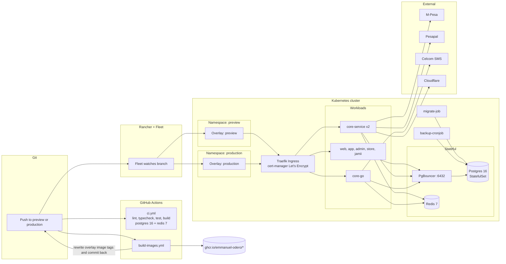

### 9.4 Cloud and Hosting

**Primary: a Rancher-managed Kubernetes cluster** with Fleet, Kustomize, Traefik ingress,
cert-manager (Let's Encrypt, HTTP-01 via a shared wildcard) and GHCR.

**No other hosting target is used.** Earlier PaaS blueprints (Render) are
retired, and their manifests have been removed from the repo.

**Terraform has not been started.** `infra/README.md` targets AWS `af-south-1` or a Kenyan
provider, with data residency gating Phase 0. The pilot plan is Oracle Always Free plus Coolify at
roughly $30/month from Phase 1.

**TLS notes.** DNS forbids a CNAME at the apex, so the apex A record is managed directly and `www`
redirects to it.

### 9.5 Containerisation and Orchestration

| Image                         | Base                                 | Notes                                                                                                                                                                                                                                                                                                                                                          |
| ----------------------------- | ------------------------------------ | -------------------------------------------------------------------------------------------------------------------------------------------------------------------------------------------------------------------------------------------------------------------------------------------------------------------------------------------------------------- |
| `docker/Dockerfile.next`      | Debian slim                          | One file, five images via `--build-arg APP=web\|app\|admin\|store\|jamii`. **Debian, not Alpine** — Prisma's engine is generated against host libc, and on musl it needs `binaryTargets`; a missing engine ships green and dies at first query. `NEXT_PUBLIC_*` are build inputs, which is why testnet and production get separate images from the same commit |
| `docker/Dockerfile.core`      | Debian slim                          | Runs TS source through `tsx` — forced, because the shared packages have no build step. Runs as uid 1001, typechecks at build time                                                                                                                                                                                                                              |
| `services/core-go/Dockerfile` | `golang:1.25-alpine` → `alpine:3.20` | `CGO_ENABLED=0` static binary. No Go toolchain in the runtime, per ADR-0004                                                                                                                                                                                                                                                                                    |

**Both Node Dockerfiles typecheck at build time**, so a type error fails the build rather than the
first request that happens to hit the broken module.

**Dev images.** `core-go` uses Air with `poll = true` and `stop_on_error = true`; the Node dev
service uses `CHOKIDAR_USEPOLLING=1`. Polling, not fsnotify, because Docker Desktop's virtiofs does
not deliver inotify events. `stop_on_error` keeps the previous process serving when a rebuild fails.

**Local stack.** `docker-compose.yml`, 20 KB, two profiles (`default`, `cecf`):

| Port                             | Service                                                                              |
| -------------------------------- | ------------------------------------------------------------------------------------ |
| 3000 / 3001 / 3002 / 3003 / 3004 | web / app / admin / store / jamii                                                    |
| 4000 / 4100                      | core-service / core-go                                                               |
| 5432 / 6432 / 6379               | postgres / pgbouncer / redis                                                         |
| 1025 / 8025                      | mailhog SMTP sink + UI                                                               |
| 8026 / 8027                      | mock-sms Celcom mock + UI                                                            |
| 8080                             | adminer                                                                              |
| 80                               | nginx vhost router (`store.esoko.test`, `jamii.esoko.test`, `*.childeldercare.test`) |
| 3306 / 8090                      | cecf-mariadb / cecf-wordpress (`cecf` profile)                                       |

---

## 10. Testing Strategy

### 10.1 Current state

| Suite             | Location                                      | Count           | Notes                                                                                                                                           |
| ----------------- | --------------------------------------------- | --------------- | ----------------------------------------------------------------------------------------------------------------------------------------------- |
| Playwright E2E    | `apps/app/e2e/`                               | 2 specs         | `signin.spec.ts` (client-only, no DB), `org-portal.spec.ts` (redirects, hotel/courier render, axe). Live-session tests skip when `NO_SESSION=1` |
| Playwright config | `apps/app/playwright.config.ts`               | 1               | `@axe-core/playwright` a11y assertions                                                                                                          |
| Vitest            | `packages/domain`, `packages/ui`              | 2 packages      | `test: vitest run`                                                                                                                              |
| Go tests          | `internal/{authsvc,config,dbx}`               | ~20 `*_test.go` | Includes `TestNoMessageForUCS2`, `parcel_receiver_auth_test.go`, `parcel_delivery_test.go`                                                      |
| Flutter           | `mobile/esoqo_app/test/`, `integration_test/` | —               |                                                                                                                                                 |
| Pilot smoke       | `scripts/pilot-check.sh`                      | 1               | One-SACCO scan-to-pay, fare and voucher flow against `http://localhost:4100`. `TOUT_TOKEN` (PIN 444444), `PASSENGER_TOKEN` (+254700300200)      |

Root scripts: `lint`, `typecheck`, `test`, `test:a11y`, plus `db:migrate`/`db:seed`/`db:reset`/
`db:studio` and `stack:up`/`stack:down`/`stack:logs`/`stack:ps`.

### 10.2 Gaps in the current strategy

These are real and should be planned, not glossed over:

1. **No coverage measurement.** No coverage config for any of the three test runners, no Codecov,
   and no Go coverage script. A coverage number is currently unavailable.
2. **No Go coverage script**, and `internal/httpapi` — the 364-route surface — has no unit tests at
   all. Testing is concentrated in `authsvc`, `config` and `dbx`.
3. **Broken `test:a11y` for `apps/web`.** `apps/web/package.json` declares `"test:a11y":
"playwright test"` but there is no `apps/web/playwright.config.ts`, so the root `test:a11y`
   script fails for that workspace.
4. **No formatting enforcement.** Prettier `^3.4.2` is a root devDependency with **no
   `.prettierrc`**. Biome is not present. Formatting is currently unenforced.
5. **CI runs `ci.yml` in parallel with `build-images.yml`.** A failing typecheck can therefore
   still produce and publish an image.

### 10.3 Recommended targets

| Metric                                                                 | Current         | Target                                       |
| ---------------------------------------------------------------------- | --------------- | -------------------------------------------- |
| TypeScript statement coverage                                          | unmeasured      | 70% on `packages/domain` and `packages/db`   |
| Go coverage on `internal/money`, `internal/ledger`, `internal/fleetqr` | unmeasured      | 90% — these are the money and security paths |
| Go coverage on `internal/httpapi`                                      | ~0              | 50% on the parcel and ticket handlers        |
| E2E specs                                                              | 2               | Cover the four pilot journeys end to end     |
| a11y                                                                   | `apps/app` only | All five apps                                |
| Mutation testing on `internal/money`                                   | none            | Consider for the money path only             |

**Priority order for test investment**, given the risk profile: money arithmetic → authorisation
(`requireCapability`, `AssertOwnsOrg`, `:own`) → payment callback verification → the parcel
lifecycle → everything else.

---

## 11. Appendices

### 11.1 Glossary

| Term                             | Definition                                                                                                         |
| -------------------------------- | ------------------------------------------------------------------------------------------------------------------ |
| **Actor**                        | The entity performing an action: `SUBJECT`, `STAFF`, `AGENT`, `SYSTEM` or `ISSUER`                                 |
| **ADR**                          | Architecture Decision Record. In `docs/adr/`. Binding on this document                                             |
| **Agent**                        | A cashier or scanner signed in at a till, authorised by matching rather than ownership                             |
| **Capability**                   | A scoped permission string. Roles are bundles of capabilities                                                      |
| **Ctx**                          | The authorisation context: actor identity plus capabilities, `__verified: true` when built from a verified session |
| **DAL**                          | Data Access Layer. `packages/db/src/dal` and `internal/dbx`. The security boundary                                 |
| **Fleet**                        | Rancher's GitOps agent. Applies the overlay, corrects drift                                                        |
| **GSM-7 / UCS-2**                | SMS character encodings. One non-GSM-7 rune halves the per-segment budget                                          |
| **Jamii**                        | Whitelabel community organisation site                                                                             |
| **Opaque session**               | A random session identifier stored server-side. Not a JWT. Revocable                                               |
| **Overlay**                      | A Kustomize directory layering environment-specific image tags and hosts onto the base                             |
| **PKG / TKT / TRIP / VCH / ESK** | Short-code prefixes from `fleetqr`                                                                                 |
| **Posting**                      | A double-entry ledger line. The only place money is recorded                                                       |
| **RSL / chama**                  | Rotating savings and credit group savings and loans entity / the Swahili term for it                               |
| **Two planes**                   | Web plane (`apps/*`, request-scoped) and core plane (`services/*`, always-on). ADR-0001                            |

### 11.2 Open issues and risks

Ordered by severity. Items 1–3 need attention before the SDD can be considered fully accurate.

| #   | Issue                                                                                                                                                                                                                                                               | Impact                                                                                                                                           | Recommendation                                                                                                                                                                                                 |
| --- | ------------------------------------------------------------------------------------------------------------------------------------------------------------------------------------------------------------------------------------------------------------------- | ------------------------------------------------------------------------------------------------------------------------------------------------ | -------------------------------------------------------------------------------------------------------------------------------------------------------------------------------------------------------------- |
| 1   | **Live Rancher API bearer token on disk** in `.kube/config/local.yml`                                                                                                                                                                                               | Cluster compromise if the machine is lost or the file is copied                                                                                  | **Rotate immediately.** Move to a secret manager. Confirm the file stays untracked                                                                                                                             |
| 2   | **No Row-Level Security is actually enabled.** `01-extensions.sql` creates `esoqo_app ... NOBYPASSRLS` and comments that ownership never bypasses RLS, but **no migration contains `ROW LEVEL SECURITY`.** The grant is a no-op; all isolation is application-level | A DAL bug is a data-isolation breach with no second line of defence                                                                              | Either enable RLS on the org-scoped tables, or correct the comment so it does not assert a protection that is not there. The comment is currently the more dangerous of the two, because it reads as a control |
| 3   | **Ingress controller mismatch.** Both overlays set `ingressClassName: traefik` but carry `nginx.ingress.kubernetes.io/*` annotations (`proxy-body-size`, `from-to-www-redirect`, `proxy-read-timeout`)                                                              | If Traefik is active, those annotations are silently ignored — the **12 MB parcel-upload limit and the `www`→apex redirect may not be in force** | Convert to Traefik middleware CRDs (`IngressRoute`) or confirm the controller is actually nginx. Verify the 12 MB limit empirically                                                                            |
| 4   | `packages/payments/src/{mpesa,pesapal}.ts` lack the `server-only` marker despite holding provider credentials                                                                                                                                                       | Nothing mechanically prevents a future client import from bundling them                                                                          | Add `import 'server-only'` to both                                                                                                                                                                             |
| 5   | Mixed-image auth in `core-go` — `Ctx` carries generic `OrgID`/`OrgType` _and_ a `DEPRECATED` `ParcelOrgID`                                                                                                                                                          | Divergence risk between the two authorisation paths during the transition                                                                        | Complete the migration and delete the deprecated field                                                                                                                                                         |
| 6   | `Decimal(12,2)` caps a single amount at 10,000,000,000.00                                                                                                                                                                                                           | Adequate for the pilot; constrains before multi-currency                                                                                         | Revisit before multi-currency, or move fully to `BigInt` minor units                                                                                                                                           |
| 7   | ADR-0002 is cited by ADR-0005 but does not exist                                                                                                                                                                                                                    | The connection-pooling decision is undocumented                                                                                                  | Write ADR-0002 (PgBouncer transaction pooling, `DIRECT_DATABASE_URL` split)                                                                                                                                    |
| 8   | `services/core` runs TypeScript through `tsx` at runtime; `tsx` is a production dependency and the whole workspace is installed                                                                                                                                     | Large image, high memory (~500 MB/replica), no minification                                                                                      | Give `packages/{db,domain,auth,payments}` real build outputs. Highest-leverage performance item                                                                                                                |
| 9   | `build-images.yml` runs in parallel with `ci.yml`                                                                                                                                                                                                                   | An image can be published for a commit whose typecheck failed                                                                                    | Gate image publication on CI success                                                                                                                                                                           |
| 10  | `mobile/esoko_app/` contains only `android/` and `ios/`, with no `lib/` and no `pubspec.yaml`                                                                                                                                                                       | Confusing dead code                                                                                                                              | Delete                                                                                                                                                                                                         |
| 11  | No Prettier config, no coverage measurement, broken `test:a11y` for `apps/web`, zero tests on `internal/httpapi`                                                                                                                                                    | Quality gates are weaker than they appear                                                                                                        | See §10.2 and §10.3                                                                                                                                                                                            |
| 12  | mTLS + signed service tokens between planes (ADR-0001) are **not implemented**                                                                                                                                                                                      | Plane-to-plane calls are currently trusted by network position                                                                                   | Implement before the second cluster or a third party gets in-cluster access                                                                                                                                    |
| 13  | No DPIA; no SACCO Societies Act compliance implementation                                                                                                                                                                                                           | Regulatory exposure as the platform scales past pilot                                                                                            | Commission the DPIA before handling real member data at volume                                                                                                                                                 |

**Brand and visual identity** — items 14–22 were found while documenting §6.2. They are cosmetic
rather than structural, but items 18 and 22 have accessibility and maintenance consequences.

| #   | Issue                                                                                                                                                                                                                                                                                                                                                                                                                                                                                                                                                                                                      | Impact                                                                                                                                                                                                                                                                                               | Recommendation                                                                                                      |
| --- | ---------------------------------------------------------------------------------------------------------------------------------------------------------------------------------------------------------------------------------------------------------------------------------------------------------------------------------------------------------------------------------------------------------------------------------------------------------------------------------------------------------------------------------------------------------------------------------------------------------- | ---------------------------------------------------------------------------------------------------------------------------------------------------------------------------------------------------------------------------------------------------------------------------------------------------- | ------------------------------------------------------------------------------------------------------------------- |
| 14  | **`icon.svg` is a broken wrapper.** It contains only `<image href="/icons/icon-192.png"/>`, and `icons/` exists solely in `apps/app/public/`. On `web`, `admin`, `jamii` and `store` the icons sit at the public root, so the path 404s. `apps/app/public/sw.js` precaches it                                                                                                                                                                                                                                                                                                                              | Missing icon; a 404 in the service-worker precache list                                                                                                                                                                                                                                              | Replace with a self-contained vector mark, or delete the file and remove it from the `sw.js` precache list          |
| 15  | **Served filenames still say "esoko"** — `esoko-logo.png`, `esoko-logo-light.png`, `esoko-logo-dark.png` in 4 apps, referenced by `Logo.tsx` and `Chrome.tsx` (13 call sites)                                                                                                                                                                                                                                                                                                                                                                                                                              | Stale brand in the URL namespace, confusing for anyone reading the markup                                                                                                                                                                                                                            | Rename to `esoqo-*` and update the two components in one commit                                                     |
| 16  | **`esoqo-logo.png` denotes three different images.** admin gets the 2054 × 766 lockup, jamii the 537 × 464 mark, web the 818 × 305 lockup — all byte-different under one name                                                                                                                                                                                                                                                                                                                                                                                                                              | Any code that assumes a filename has a stable meaning is wrong in at least one app                                                                                                                                                                                                                   | Adopt role-based names: `logo-primary`, `logo-inverse`, `mark`, `icon-192`                                          |
| 17  | **The parcel label pipeline hardcodes a full lockup.** `apps/admin/.../labels/constants.ts` sets `ESOQO_LOGO_URL = '/esoqo-logo.png'`, which in `admin` resolves to the 2054 × 766 full lockup, not the mark                                                                                                                                                                                                                                                                                                                                                                                               | A printed shipping label carries the full wordmark rather than a compact mark. Ink cost, and a cluttered label                                                                                                                                                                                       | Point labels at the mark asset, and size it explicitly for print                                                    |
| 18  | **`Atkinson Hyperlegible` is declared in `apps/app` only**, but `tokens.css` applies it globally via `html[data-font="legible"]`                                                                                                                                                                                                                                                                                                                                                                                                                                                                           | The high-legibility accessibility setting silently falls back to `system-ui` on `web`, `admin` and `jamii`                                                                                                                                                                                           | Load Atkinson in all four apps that import `tokens.css`, or scope the toggle per app                                |
| 19  | **The logo palette is absent from `tokens.css`.** Wordmark navy `#042C62` ≠ `--navy` `#0A2E4D`; mark red `#F7001C` ≠ `--red` `#CE2B2B`; and the mark is a red→amber gradient that no token expresses                                                                                                                                                                                                                                                                                                                                                                                                       | Two independent definitions of the brand that cannot drift-check each other. Nothing catches a future logo recolour                                                                                                                                                                                  | Add `--logo-navy`, `--logo-red`, `--logo-orange`, `--logo-amber`, `--logo-gradient` to `tokens.css`                 |
| 20  | **`favicon.ico` contains only a 16 × 16 image, but all four manifests declare `"sizes": "16x16 32x32"`**                                                                                                                                                                                                                                                                                                                                                                                                                                                                                                   | Declared capability does not match content; high-DPI favicons upscale and look soft                                                                                                                                                                                                                  | Build a real multi-resolution `.ico` (16 + 32 + 48), or correct the manifests to `16x16`                            |
| 21  | **45 brand files are hand-copied from 11 sources across 5 apps with no sync script**, so `assets/branding/` and the served copies can drift silently. `esoko-logo.png` and `esoko-logo-light.png` are already byte-identical duplicates                                                                                                                                                                                                                                                                                                                                                                    | Every other item in this group recurs the moment a logo changes                                                                                                                                                                                                                                      | Add `scripts/sync-branding.mjs` and fail CI on a hash mismatch. Do this first — it makes items 14–16 and 20 durable |
| 22  | **`apps/web/src/components/Chrome.tsx` defines its own local `Logo` that shadows the shared `@esoqo/ui` one.** It imports only `Icon` from the package, then re-declares the same component with a different filename pair (`/esoqo-logo.png` instead of `/esoko-logo-light.png`). Its comment states the inverse variant _"still falls back to the legacy asset until a white-text export exists"_ — **but the white-text export does exist**: `esoqo-full-logo-removebg-preview.png` is 77.5% transparent with near-white opaque pixels, and it is served as `esoko-logo-dark.png` in `apps/web/public/` | Two implementations of one design-system component. In `web` they resolve to the same image today, so there is no visible defect — but the next logo change fixes one and silently misses the other. The stale comment will also send an engineer to commission an asset that is already in the repo | Delete the local `Logo` from `Chrome.tsx` and import it from `@esoqo/ui`. Update or delete the comment              |

**Not defects, and worth keeping:**

- `apps/store` ships icons but no logo. Correct: a tenant storefront shows the merchant's mark, not
  the platform's. Store accepts an uploaded logo and favicon per store, capped at 2 MB.
- `jamii`'s `theme_color` of `#16233B` diverges from the platform navy. Correct for a whitelabel
  surface with its own identity.
- The high-contrast mode, 44 px target-size floor and 3 px focus ring are accessibility
  commitments, not incidental CSS. The 44 px floor over the WCAG 2.2 minimum of 24 px is a
  deliberate decision, stated in the token file: _"the real user is standing in a market with cold
  hands."_

### 11.3 Change history

| Version | Date       | Author      | Changes                                                                                                                                                                                                                                                                                                                            |
| ------- | ---------- | ----------- | ---------------------------------------------------------------------------------------------------------------------------------------------------------------------------------------------------------------------------------------------------------------------------------------------------------------------------------- |
| 1.0     | 2026-09-25 | Engineering | Initial SDD. Captures the system as built at `d6fe6e8` on branch `preview`. Sections 1–10 from code, ADRs and deployment config; §11.2 records 13 open issues, of which 3 are rated high.                                                                                                                                          |
| 1.1     | 2026-09-25 | Engineering | Added §6.2 Brand and Visual Identity: logo assets with rendered previews, measured logo palette, design tokens, typography, accessibility commitments, PWA identity, and asset distribution. Added §11.2 items 14–22 covering brand defects found during that work, two of which carry accessibility and maintenance consequences. |

### 11.4 Diagram index

| §     | Diagram                               | Type      |
| ----- | ------------------------------------- | --------- |
| 2.4   | System context                        | flowchart |
| 3.1   | System architecture / two planes      | flowchart |
| 3.4.1 | Authentication and authorisation      | sequence  |
| 3.4.2 | Payment, ledger and notification flow | flowchart |
| 3.4.3 | Parcel lifecycle                      | state     |
| 4.7   | `APP_ENV` switch                      | flowchart |
| 5.1   | Identity ER                           | erDiagram |
| 5.2   | Commerce ER                           | erDiagram |
| 5.3   | Transport ER                          | erDiagram |
| 5.4   | Parcel ER                             | erDiagram |
| 5.5   | Groups / Jamii ER                     | erDiagram |
| 7.5   | Threat model                          | flowchart |
| 9.3   | Infrastructure / GitOps               | flowchart |

### 11.5 Rendering the diagrams

Every diagram above is a self-contained Mermaid block and renders on GitHub, GitLab, and in any
editor with Mermaid support. To produce SVGs for embedding elsewhere, extract the blocks and run:

```bash
mmdc -i diagram.mmd -o diagram.svg
```

All 13 blocks were parse-validated against Mermaid 11 at the time of writing.
